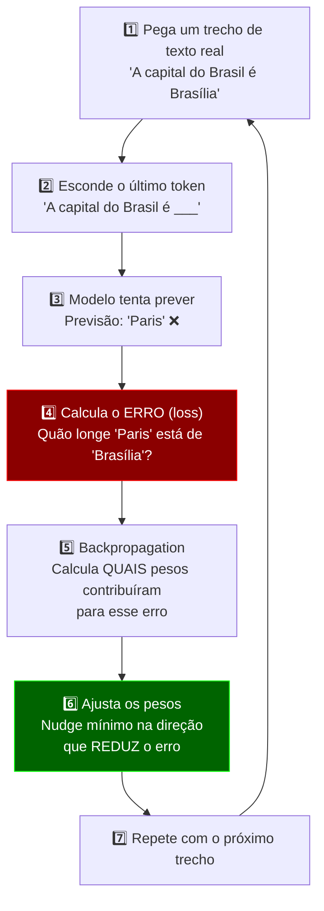
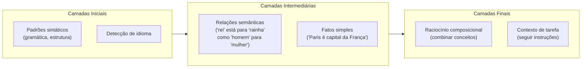

# 🎓 O Que Significa "O Modelo Aprendeu"?

## A Resposta Curta

"Aprender" para um LLM significa **ajustar bilhões de números (pesos)** de forma que, ao receber um texto, o modelo erre cada vez menos na previsão do próximo token.

Não existe um banco de dados interno. Não existe "memória" no sentido humano. O conhecimento está **codificado na configuração dos pesos** — padrões numéricos distribuídos pela rede.

---

## 1. Antes de Treinar: Ruído Aleatório

Quando um modelo é criado, seus bilhões de parâmetros são inicializados com **valores aleatórios**. Nesse momento, ele é essencialmente um gerador de lixo:

```
Entrada: "A capital do Brasil é"
Saída:   "flúor bateria zxqw mesa 77 cachorro..."
```

Os pesos não significam nada. O modelo não "sabe" nada.

---

## 2. O Loop de Aprendizado

O treinamento é um ciclo que se repete **bilhões de vezes**:



### Em números concretos

| Aspecto | Escala típica |
|---|---|
| Parâmetros (pesos) a ajustar | 7 bilhões a 1.8 trilhões |
| Exemplos de texto vistos | ~15 trilhões de tokens |
| Iterações de ajuste | Milhões |
| Tempo | Semanas a meses |
| Custo | \$2M–\$100M+ em GPUs |

---

## 3. O Que é um "Peso"?

Um peso é **um único número decimal** (ex: `0.0037`, `-1.284`, `0.551`).

Cada peso controla **quanto um sinal é amplificado ou atenuado** ao passar de um neurônio para outro dentro da rede.

```
Neurônio A ──[peso: 0.8]──► Neurônio B    (sinal forte)
Neurônio A ──[peso: 0.01]──► Neurônio C   (sinal quase ignorado)
Neurônio A ──[peso: -0.5]──► Neurônio D   (sinal invertido/inibido)
```

Isoladamente, um peso não significa nada. **O conhecimento emerge do padrão coletivo de bilhões de pesos trabalhando juntos** — assim como uma imagem emerge de milhões de pixels, mas nenhum pixel sozinho "é" a imagem.

---

## 4. Gradiente Descendente — A Matemática do Aprender

O algoritmo central é o **gradiente descendente** (gradient descent). A intuição:

> Imagine que você está num vale coberto de neblina e quer chegar ao ponto mais baixo.  
> Você não enxerga o vale inteiro. Mas pode sentir a **inclinação do chão sob seus pés**.  
> A cada passo, você caminha na direção que desce mais.  
> Eventualmente, chega a um ponto baixo.

Formalmente:

$$\theta_{t+1} = \theta_t - \eta \cdot \nabla L(\theta_t)$$

Onde:
- \(\theta\) = todos os pesos do modelo (bilhões de números)
- \(\eta\) = *learning rate* (tamanho do passo — tipicamente 0.0001)
- \(\nabla L\) = gradiente da função de perda (a "inclinação" — em qual direção o erro cresce)
- O sinal **negativo** faz o modelo ir na direção que **reduz** o erro

> [!NOTE]
> O learning rate é criticamente importante. Muito grande → o modelo "pula" demais e nunca converge. Muito pequeno → o treinamento leva uma eternidade. Encontrar o valor certo é parte da arte do treinamento.

---

## 5. O Que Fica Codificado nos Pesos?

Pesquisadores descobriram (via *mechanistic interpretability*) que após o treinamento, diferentes partes da rede se especializam:



### Exemplos concretos do que está "nos pesos":

| O modelo "aprendeu" | Evidência |
|---|---|
| Gramática do português | Gera frases gramaticalmente corretas quase sempre |
| Que "água" e "líquido" são relacionados | Seus vetores internos estão próximos no espaço |
| Padrões de código Python | Completa funções com sintaxe correta |
| Que "2+3=5" | Reproduz aritmética simples (mas falha em contas grandes — é padrão, não cálculo real) |
| Tom formal vs. informal | Adapta o estilo ao contexto |

---

## 6. A Analogia Mais Honesta

> [!IMPORTANT]
> **Aprender para um LLM NÃO é como aprender para um humano.**

| Aspecto | Humano | LLM |
|---|---|---|
| **Onde fica o conhecimento** | Sinapses biológicas (conexões entre neurônios) | Pesos numéricos (conexões entre neurônios artificiais) |
| **Como aprende** | Experiência multissensorial, emoção, repetição, sono | Otimização matemática sobre texto |
| **Pode "esquecer"?** | Sim, naturalmente | Não esquece — mas pode ser sobrescrito por novos treinamentos (*catastrophic forgetting*) |
| **Entende o que aprendeu?** | Sim (debate filosófico, mas geralmente aceito) | **Debate aberto e não resolvido.** Comporta-se *como se* entendesse, mas pode ser apenas correlação estatística sofisticada |
| **Generaliza?** | Sim, para domínios completamente novos | Sim, surpreendentemente — mas de formas imprevisíveis |

A analogia mais honesta:

> O modelo é como alguém que **leu todos os livros do mundo, mas nunca viveu nada**. Consegue falar sobre nadar com perfeição técnica, mas nunca sentiu a água. Quando as perguntas se alinham com padrões que ele viu, parece genial. Quando saem desses padrões, pode inventar com total confiança.

---

## 7. O Momento "Eureka" — Capacidades Emergentes

Algo fascinante acontece em escala: capacidades que **não foram explicitamente treinadas** aparecem quando o modelo fica grande o suficiente.

| Capacidade | Treinado para isso? | Como surge? |
|---|---|---|
| Tradução | ❌ Não diretamente | Viu textos paralelos na web e "descobriu" o padrão |
| Aritmética simples | ❌ Não diretamente | Padrões em textos que incluem contas |
| Raciocínio lógico | ❌ Não diretamente | Exposição a provas, argumentos, código |
| Chain-of-Thought | ❌ Não diretamente | Emerge em modelos >~60B parâmetros |

> [!TIP]
> É por isso que se diz que LLMs têm **capacidades emergentes** — comportamentos que surgem espontaneamente da escala, não da programação explícita. É uma das razões pelas quais a área é tão difícil de prever.

---

## 8. O Que "Aprender" NÃO Significa

> [!CAUTION]
> Cuidado com antropomorfismos.

- ❌ O modelo **não memoriza** texto como um HD. Ele comprime padrões estatísticos.
- ❌ O modelo **não raciocina** como um humano. Ele simula raciocínio via padrões de texto.
- ❌ O modelo **não sabe que não sabe**. Não tem metacognição genuína — por isso alucina.
- ❌ O modelo **não aprende com você em tempo real** (a menos que seja re-treinado ou use memória externa).
- ❌ O modelo **não tem intenção**. Ele gera a continuação estatisticamente mais provável dado o contexto.

---

## Resumo em Uma Frase

> **"Aprender" = bilhões de números foram ajustados, milímetro por milímetro, ao longo de trilhões de exemplos, até que o padrão coletivo desses números reproduza fielmente os padrões da linguagem humana — sem nunca ter entendido uma única palavra.**
