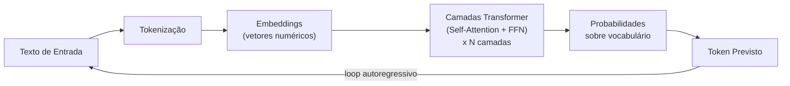
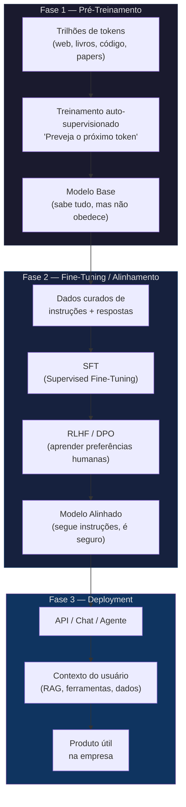
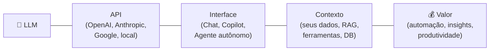
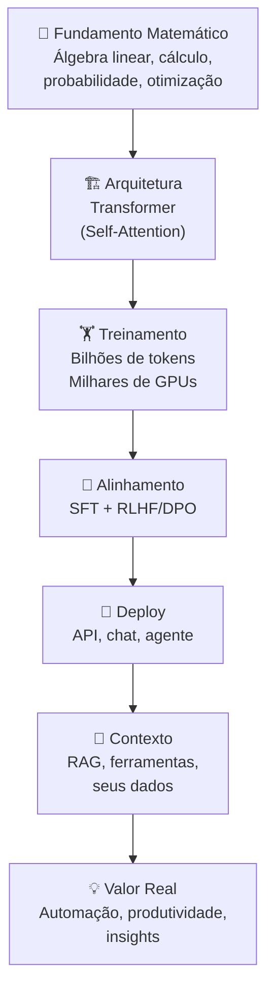

# 🧠 Large Language Models (LLMs) — Guia Aprofundado

## 1. O Que é, Concretamente?

Um LLM é uma **rede neural artificial** com bilhões (ou trilhões) de parâmetros numéricos, treinada para fazer uma única coisa surpreendentemente bem:

> **Dado um trecho de texto, prever qual é o próximo token (palavra ou pedaço de palavra) mais provável.**

Essa tarefa aparentemente simples, quando executada em escala massiva, produz um sistema capaz de:
- Resumir documentos
- Traduzir idiomas
- Escrever código
- Raciocinar sobre problemas
- Manter diálogos coerentes

---

## 2. Arquitetura: O Transformer

Desde 2017 (paper *"Attention Is All You Need"* do Google), quase todos os LLMs modernos são baseados na arquitetura **Transformer**:

### Componentes-chave:

| Componente | O que faz |
|---|---|
| **Tokenizador** | Quebra texto em pedaços (tokens). "Inteligência" → `["Int", "elig", "ência"]` |
| **Embeddings** | Converte cada token em um vetor numérico de alta dimensão (ex: 4096 dimensões) |
| **Self-Attention** | Permite que cada token "olhe" para todos os outros tokens do contexto, ponderando a relevância de cada um. É o coração do Transformer. |
| **Feed-Forward Network (FFN)** | Processa cada posição individualmente com camadas densas — aqui fica armazenado grande parte do "conhecimento" factual |
| **Softmax final** | Gera uma distribuição de probabilidade sobre todo o vocabulário (~32k–128k tokens) |

> [!TIP]
> O mecanismo de **Self-Attention** é o que torna LLMs tão poderosos. Ele permite que o modelo entenda relações de longa distância — por exemplo, que o pronome "ele" na frase 500 se refere a "João" mencionado na frase 3.

---

## 3. Ciclo de Vida: De Dados Brutos a Assistente

Um LLM passa por **três grandes fases** antes de estar pronto para uso:

### 3.1 Pré-Treinamento (semanas/meses, milhões de \$)

- **Dados**: Crawls da internet, livros digitalizados, repositórios de código, artigos científicos, Wikipedia, etc.
- **Objetivo**: Minimizar a *loss* de predição do próximo token.
- **Resultado**: Um modelo que "sabe" gramática, fatos, lógica, código — mas não sabe *obedecer* instruções. Se você perguntar algo, ele pode simplesmente continuar o texto como se fosse um artigo da Wikipedia.

### 3.2 Alinhamento (dias/semanas)

| Técnica | Como funciona |
|---|---|
| **SFT** (Supervised Fine-Tuning) | Treina com pares (instrução → resposta ideal), ensinando o modelo a seguir ordens |
| **RLHF** (Reinforcement Learning from Human Feedback) | Humanos ranqueiam respostas; um *reward model* aprende as preferências; o LLM é otimizado via PPO para maximizar a recompensa |
| **DPO** (Direct Preference Optimization) | Alternativa mais simples ao RLHF — otimiza preferências diretamente, sem reward model separado |

> [!IMPORTANT]
> Sem alinhamento, o modelo base do GPT-4 ou Claude seria quase inutilizável como assistente. O alinhamento é o que transforma "um completador de texto muito bom" em "um assistente que segue instruções, recusa pedidos perigosos e admite incerteza".

### 3.3 Deployment — Onde o Valor Aparece

O modelo sozinho é como um **motor sem carro**. Para gerar valor real:

---

## 4. Conceitos Essenciais

### 4.1 Tokens ≠ Palavras

| Texto | Tokens (aprox.) |
|---|---|
| "Olá" | 1 token |
| "Inteligência Artificial" | ~3-4 tokens |
| 1 página de texto | ~300-400 tokens |
| 1 livro médio | ~80.000-100.000 tokens |

O custo de APIs (como OpenAI) é cobrado **por token** — tanto de entrada quanto de saída.

### 4.2 Janela de Contexto

É o "campo de visão" do modelo — quantos tokens ele consegue processar de uma vez:

| Modelo | Contexto |
|---|---|
| GPT-3.5 | 4K–16K tokens |
| GPT-4o | 128K tokens |
| Claude 3.5 / Opus 4 | 200K tokens |
| Gemini 1.5/2.0 | até 2M tokens |

> [!NOTE]
> Contexto maior ≠ melhor sempre. Modelos tendem a ter *performance degradada* no meio de contextos muito longos (o famoso problema "Lost in the Middle"). Além disso, mais contexto = mais custo e latência.

### 4.3 Temperatura e Amostragem

Quando o modelo prevê o próximo token, ele gera probabilidades. A **temperatura** controla a aleatoriedade:

| Temperatura | Comportamento |
|---|---|
| `0.0` | Determinístico — sempre escolhe o token mais provável. Bom para código, dados estruturados. |
| `0.3–0.7` | Equilíbrio entre criatividade e coerência. Bom para texto geral. |
| `1.0+` | Muito criativo/aleatório. Bom para brainstorming, ficção. Risco de incoerência. |

### 4.4 Alucinações

LLMs **não consultam um banco de dados de fatos**. Eles geram texto estatisticamente plausível. Quando não "sabem" algo, podem inventar com total confiança.

**Mitigações:**
- **RAG** (Retrieval-Augmented Generation) — busca informações reais antes de responder
- **Grounding** — conectar o modelo a fontes verificáveis
- **Chain-of-Thought** — forçar o modelo a raciocinar passo a passo
- **Verificação humana** — especialmente em domínios críticos (medicina, direito, finanças)

---

## 5. Escala: Por que "Maior" Importou (até agora)

As famosas **Scaling Laws** (Kaplan et al., 2020) mostraram que a performance melhora de forma previsível com:

1. **Mais parâmetros** (tamanho do modelo)
2. **Mais dados** de treinamento
3. **Mais compute** (FLOPs de treinamento)

| Modelo | Parâmetros | Ano |
|---|---|---|
| GPT-2 | 1.5B | 2019 |
| GPT-3 | 175B | 2020 |
| LLaMA 2 | 7B–70B | 2023 |
| GPT-4 | ~1.8T (estimado, MoE) | 2023 |
| LLaMA 3.1 | 8B–405B | 2024 |

> [!NOTE]
> A tendência atual está migrando de "modelos maiores" para **modelos mais eficientes** (destilação, quantização, MoE — Mixture of Experts) e **mais dados de melhor qualidade**. O LLaMA 3 de 8B rivaliza com o GPT-3.5 de 175B.

---

## 6. Modelos Abertos vs. Fechados

| Aspecto | Abertos (LLaMA, Mistral, Qwen) | Fechados (GPT-4, Claude, Gemini) |
|---|---|---|
| **Acesso aos pesos** | ✅ Sim | ❌ Não |
| **Customização** | Fine-tuning completo | Apenas via API/prompts |
| **Custo de uso** | Infra própria (GPU) | Pay-per-token |
| **Privacidade** | Dados ficam locais | Dados passam pelo provider |
| **Performance SOTA** | Competitivo, mas geralmente atrás | Geralmente melhor |
| **Ideal para** | Casos com dados sensíveis, alto volume, customização pesada | Prototipação rápida, acesso ao estado-da-arte |

---

## 7. O Que o Modelo NÃO É

> [!CAUTION]
> Entender as **limitações** é tão importante quanto entender as capacidades.

| Mito | Realidade |
|---|---|
| "O modelo entende" | Ele manipula padrões estatísticos. Não há evidência de compreensão genuína (debate aberto na pesquisa) |
| "Ele sabe tudo até hoje" | O conhecimento é congelado na data de corte do treinamento (knowledge cutoff) |
| "Ele pensa como humano" | Não tem memória persistente, emoções, objetivos ou consciência |
| "Mais tokens = melhor resposta" | Respostas mais longas não são necessariamente melhores; verbosidade pode diluir a qualidade |
| "É seguro por padrão" | Sem guardrails adequados, pode gerar conteúdo prejudicial, enviesado ou inseguro |

---

## 8. Resumo Visual — Da Teoria ao Produto

---

*A magia dos LLMs não está em nenhuma dessas peças individualmente — está na emergência de capacidades surpreendentes quando todas elas se combinam em escala.*
