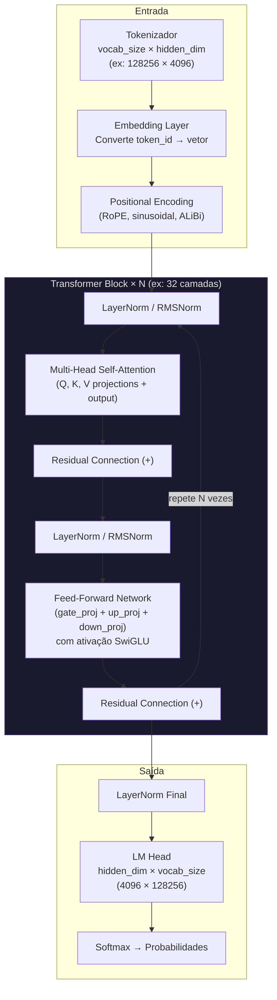
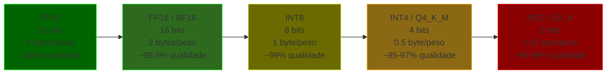
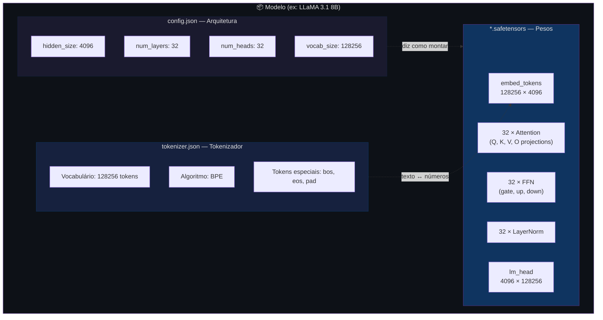

# 🔬 Anatomia Técnica de um Modelo LLM

## 1. O Que É um Modelo, Fisicamente?

Um modelo de IA é, no final das contas, **um ou mais arquivos contendo bilhões de números decimais organizados em matrizes multidimensionais (tensores)**, acompanhados de metadados que descrevem a arquitetura.

```
llama-3.1-8b-instruct/
├── config.json                  ← Arquitetura (quantas camadas, dimensões, etc.)
├── tokenizer.json               ← Vocabulário + regras de tokenização
├── tokenizer_config.json        ← Configurações do tokenizador
├── special_tokens_map.json      ← Tokens especiais (<bos>, <eos>, <pad>)
├── generation_config.json       ← Parâmetros default de geração
├── model-00001-of-00004.safetensors  ← Pesos (tensores) - parte 1
├── model-00002-of-00004.safetensors  ← Pesos (tensores) - parte 2
├── model-00003-of-00004.safetensors  ← Pesos (tensores) - parte 3
├── model-00004-of-00004.safetensors  ← Pesos (tensores) - parte 4
└── model.safetensors.index.json      ← Mapa de qual tensor está em qual arquivo
```

> **Isso é tudo.** Não existe código executável, não existe "inteligência" — são números + um manual (config) de como organizá-los.

---

## 2. O Que São Tensores?

Tensores são a estrutura de dados fundamental. São generalizações de matrizes para N dimensões:

| Nome | Dimensões | Exemplo | Uso no LLM |
|---|---|---|---|
| **Escalar** | 0D | `3.14` | Um único peso |
| **Vetor** | 1D | `[0.1, 0.5, 0.3]` | Bias de um neurônio |
| **Matriz** | 2D | `[[0.1, 0.2], [0.3, 0.4]]` | Pesos de uma camada linear |
| **Tensor 3D+** | 3D+ | Shape `(32, 128, 4096)` | Attention heads, embeddings em batch |

### Exemplo real — um tensor de pesos:

```python
# Tensor de pesos de uma camada de atenção do LLaMA 3.1 8B
# Shape: (4096, 4096) = 16.777.216 números decimais (só esta camada!)

tensor([[ 0.0012, -0.0034,  0.0078, ...,  0.0015],
        [-0.0023,  0.0091, -0.0002, ..., -0.0048],
        [ 0.0056, -0.0011,  0.0033, ...,  0.0027],
        ...,
        [ 0.0008,  0.0044, -0.0019, ..., -0.0063]])
```

> [!NOTE]
> Cada número nesse tensor foi ajustado durante o treinamento. A "inteligência" do modelo está no **padrão coletivo** desses milhões de números — não em nenhum deles individualmente.

---

## 3. Anatomia Interna — Camada por Camada

Um LLM no estilo Transformer (GPT, LLaMA, Mistral, etc.) é composto por blocos empilhados:



### Cada componente e seus tensores:

#### 3.1 — Embedding Layer (entrada)

```
model.embed_tokens.weight    Shape: (vocab_size, hidden_dim)
                             Ex:    (128256, 4096)
                             = 525 milhões de números
```

Converte cada token ID (um inteiro) em um vetor denso de `hidden_dim` dimensões. 
Cada linha desta matriz é a "representação" de um token no espaço vetorial do modelo.

#### 3.2 — Self-Attention (o coração)

Para **cada uma das N camadas**, existem 4 matrizes de projeção:

```
model.layers.0.self_attn.q_proj.weight   (hidden_dim, hidden_dim)  → Query
model.layers.0.self_attn.k_proj.weight   (hidden_dim, kv_dim)      → Key
model.layers.0.self_attn.v_proj.weight   (hidden_dim, kv_dim)      → Value
model.layers.0.self_attn.o_proj.weight   (hidden_dim, hidden_dim)  → Output
```

| Conceito | O que faz | Analogia |
|---|---|---|
| **Query (Q)** | "O que eu estou procurando?" | A pergunta que cada token faz |
| **Key (K)** | "O que eu tenho para oferecer?" | O rótulo de cada token |
| **Value (V)** | "Qual é meu conteúdo?" | A informação real de cada token |
| **Attention** | `softmax(Q·Kᵀ / √d) · V` | Quanto cada token deve prestar atenção em cada outro |

> [!TIP]
> **Multi-Head Attention** = rodar esse mecanismo **N vezes em paralelo** (ex: 32 heads), cada uma com uma "perspectiva" diferente. Um head pode focar em relações sintáticas, outro em semânticas, outro em posicionais.

##### Grouped-Query Attention (GQA)

Modelos modernos (LLaMA 3, Mistral) usam **GQA**: os heads de Q são mais numerosos que os de K e V, economizando memória:

```
LLaMA 3.1 8B:
  - num_attention_heads (Q):     32
  - num_key_value_heads (K, V):  8     ← 4x menos!
  - Cada grupo de 4 Q heads compartilha 1 K/V head
```

#### 3.3 — Feed-Forward Network (FFN / MLP)

Para **cada camada**, 3 matrizes (no estilo SwiGLU usado por LLaMA/Mistral):

```
model.layers.0.mlp.gate_proj.weight   (intermediate_dim, hidden_dim)  → Gate
model.layers.0.mlp.up_proj.weight     (intermediate_dim, hidden_dim)  → Up
model.layers.0.mlp.down_proj.weight   (hidden_dim, intermediate_dim)  → Down
```

```
intermediate_dim é tipicamente ~2.7× o hidden_dim
Ex: hidden=4096, intermediate=14336

Cálculo: SwiGLU(x) = down_proj( silu(gate_proj(x)) ⊙ up_proj(x) )
```

> [!NOTE]
> A FFN é onde pesquisadores acreditam que grande parte do **conhecimento factual** é armazenado. É a "memória associativa" do modelo — padrões como "Paris → capital da França" estão codificados nessas matrizes.

#### 3.4 — LayerNorm / RMSNorm

Pequenos vetores de normalização (1D) por camada:

```
model.layers.0.input_layernorm.weight      (hidden_dim,)   → 4096 números
model.layers.0.post_attention_layernorm.weight  (hidden_dim,)
```

Estabilizam o treinamento normalizando os valores entre camadas.

#### 3.5 — LM Head (saída)

```
lm_head.weight    Shape: (vocab_size, hidden_dim)
                  Ex:    (128256, 4096)
```

Projeta o vetor da última camada de volta para o espaço do vocabulário, gerando um score (logit) para cada token possível. Softmax converte esses scores em probabilidades.

---

## 4. Contagem de Parâmetros — De Onde Vem o "8B"?

Para o **LLaMA 3.1 8B**:

```python
# Embeddings
embed       = vocab_size × hidden_dim           = 128256 × 4096  =   525_336_576

# Por camada (×32 camadas):
q_proj      = hidden × hidden                   = 4096 × 4096    =    16_777_216
k_proj      = hidden × kv_dim                   = 4096 × 1024    =     4_194_304
v_proj      = hidden × kv_dim                   = 4096 × 1024    =     4_194_304
o_proj      = hidden × hidden                   = 4096 × 4096    =    16_777_216
gate_proj   = intermediate × hidden             = 14336 × 4096   =    58_720_256
up_proj     = intermediate × hidden             = 14336 × 4096   =    58_720_256
down_proj   = hidden × intermediate             = 4096 × 14336   =    58_720_256
norms (×2)  = hidden × 2                        = 4096 × 2       =         8_192
                                                                   ─────────────
por_camada  =                                                       218_112_000

# Total
total_camadas = 218_112_000 × 32                                 = 6_979_584_000
embed_in      =                                                      525_336_576
embed_out     = (geralmente compartilhado com embed_in)                        0
norm_final    =                                                          4_096
                                                                  ─────────────
TOTAL         ≈                                                    7_504_924_672
              ≈                                                    ~7.5B parâmetros
```

> O "8B" é arredondado. O modelo real tem ~7.5 bilhões de parâmetros.

---

## 5. Formatos de Arquivo

### 5.1 — Tabela Comparativa

| Formato | Extensão | Criado por | Uso principal | Seguro? |
|---|---|---|---|---|
| **SafeTensors** | `.safetensors` | Hugging Face | Padrão atual para distribuição | ✅ Sim |
| **GGUF** | `.gguf` | llama.cpp | Inferência local (CPU/GPU) | ✅ Sim |
| **PyTorch** | `.bin` / `.pt` | Meta/PyTorch | Treinamento e fine-tuning | ⚠️ Usa pickle (risco de execução de código) |
| **ONNX** | `.onnx` | Microsoft | Inferência cross-platform | ✅ Sim |
| **TensorFlow** | `.pb` / SavedModel | Google | Ecossistema TensorFlow | ✅ Sim |

### 5.2 — SafeTensors (padrão da indústria)

```
┌─────────────────────────────────────────────────┐
│ Header (JSON)                                   │
│ {                                               │
│   "model.layers.0.self_attn.q_proj.weight": {   │
│     "dtype": "bfloat16",                        │
│     "shape": [4096, 4096],                      │
│     "data_offsets": [0, 33554432]                │
│   },                                            │
│   ...                                           │
│ }                                               │
├─────────────────────────────────────────────────┤
│ Dados binários (tensores contíguos na memória)  │
│ [bytes brutos dos pesos, um após o outro]       │
└─────────────────────────────────────────────────┘
```

- **Header**: JSON com nome, tipo, shape e offset de cada tensor
- **Dados**: Bytes brutos, sem serialização complexa
- **Seguro**: Não executa código ao carregar (ao contrário de PyTorch pickle)
- **Rápido**: Memory-mapped, carrega em segundos

### 5.3 — GGUF (para rodar localmente)

Formato criado pelo projeto **llama.cpp** para inferência eficiente em CPU:

```
┌─────────────────────────────────────────────────┐
│ Magic number: "GGUF"                            │
│ Versão: 3                                       │
├─────────────────────────────────────────────────┤
│ Metadados (key-value)                           │
│   general.architecture: "llama"                 │
│   general.name: "Meta-Llama-3.1-8B-Instruct"   │
│   llama.context_length: 131072                  │
│   llama.embedding_length: 4096                  │
│   llama.block_count: 32                         │
│   llama.attention.head_count: 32                │
│   tokenizer.ggml.model: "gpt2"                 │
│   tokenizer.ggml.tokens: [...]                  │
│   ...                                           │
├─────────────────────────────────────────────────┤
│ Tensores quantizados                            │
│   (Q4_K_M, Q5_K_M, Q8_0, F16, etc.)            │
└─────────────────────────────────────────────────┘
```

- **Auto-contido**: Tokenizador + metadados + pesos em um único arquivo
- **Quantizado**: Pesos comprimidos para rodar em hardware modesto
- **Portável**: Funciona com llama.cpp, Ollama, LM Studio, etc.

---

## 6. Quantização — Comprimir o Modelo

Pesos originais são em **float32** (32 bits por número) ou **bfloat16** (16 bits). Quantizar significa reduzir a precisão para economizar memória e velocidade:



### Impacto prático:

| Formato | Tamanho LLaMA 3.1 8B | RAM necessária | Qualidade |
|---|---|---|---|
| FP32 | ~30 GB | ~32 GB | Referência (100%) |
| BF16 | ~16 GB | ~18 GB | Quase idêntico |
| INT8 (Q8_0) | ~8 GB | ~10 GB | Muito boa |
| **Q4_K_M** | **~4.9 GB** | **~7 GB** | **Boa (sweet spot)** |
| Q2_K | ~2.8 GB | ~5 GB | Degradação visível |

> [!TIP]
> **Q4_K_M** é o sweet spot para uso local — o modelo de 8B cabe em **8 GB de RAM** com qualidade muito aceitável. É o que o Ollama usa por padrão.

### Métodos de quantização:

| Método | Como funciona |
|---|---|
| **GPTQ** | Quantiza camada por camada, minimizando erro em dados de calibração |
| **AWQ** | Protege os pesos mais "importantes" (activation-aware) |
| **GGML/GGUF (K-quants)** | Quantização mista — camadas sensíveis ficam em precisão maior |
| **bitsandbytes (NF4)** | Quantização on-the-fly no carregamento, usada em QLoRA |
| **EXL2** | Quantização por bits variáveis por camada (ExLlamaV2) |

---

## 7. O config.json — O "Manual de Montagem"

Este arquivo diz como **organizar os tensores** na arquitetura correta:

```json
{
  "architectures": ["LlamaForCausalLM"],
  "hidden_size": 4096,
  "intermediate_size": 14336,
  "num_hidden_layers": 32,
  "num_attention_heads": 32,
  "num_key_value_heads": 8,
  "vocab_size": 128256,
  "max_position_embeddings": 131072,
  "rms_norm_eps": 1e-05,
  "rope_theta": 500000.0,
  "torch_dtype": "bfloat16",
  "tie_word_embeddings": false
}
```

| Campo | Significado |
|---|---|
| `hidden_size` | Dimensão dos vetores internos (largura da rede) |
| `intermediate_size` | Dimensão interna da FFN (~2.7× hidden) |
| `num_hidden_layers` | Quantas camadas Transformer empilhadas |
| `num_attention_heads` | Quantos heads de atenção paralelos |
| `num_key_value_heads` | Heads de K/V (se < attention_heads → GQA) |
| `vocab_size` | Tamanho do vocabulário do tokenizador |
| `max_position_embeddings` | Janela de contexto máxima |
| `rope_theta` | Frequência base do RoPE (encoding posicional rotativo) |
| `tie_word_embeddings` | Se embed_in e lm_head compartilham pesos |

> [!IMPORTANT]
> Sem o `config.json`, os tensores são apenas um blob de números sem sentido. Este arquivo é o **blueprint** que diz como montar a rede neural a partir dos pesos.

---

## 8. O Tokenizador — Traduzindo Texto ↔ Números

O tokenizador é uma peça **separada do modelo**, mas essencial:

```
"Olá, como você está?" 
    │
    ▼ tokenizador
[32, 2364, 28, 1303, 12354, 3366, 30]
    │
    ▼ embedding layer
[[0.012, -0.034, ...], [0.078, 0.015, ...], ...]   ← vetores de 4096 dims
```

### Tipos de tokenizador:

| Tipo | Usado por | Como funciona |
|---|---|---|
| **BPE** (Byte Pair Encoding) | GPT, LLaMA, Mistral | Mergeia pares de bytes mais frequentes iterativamente |
| **WordPiece** | BERT | Similar ao BPE, mas com likelihood |
| **SentencePiece** | T5, Gemma | Opera no nível de unicode, language-agnostic |
| **Tiktoken** | OpenAI (GPT-4) | BPE otimizado em Rust, muito rápido |

### Arquivos do tokenizador:

```
tokenizer.json             ← Vocabulário completo + regras de merge
tokenizer_config.json      ← Configurações (chat template, tokens especiais)
special_tokens_map.json    ← Mapeamento de tokens especiais:
                              <bos> = Begin of Sequence (token 1)
                              <eos> = End of Sequence (token 2)
                              <pad> = Padding
                              <unk> = Token desconhecido
```

---

## 9. Glossário Técnico Rápido

| Termo | Definição |
|---|---|
| **Parâmetro** | Um único número (peso ou bias) na rede neural |
| **Tensor** | Matriz multidimensional que armazena parâmetros |
| **Hidden size** | Dimensão dos vetores internos que fluem pela rede |
| **Layer** | Um bloco Transformer completo (Attention + FFN + Norms) |
| **Head** | Uma das N projeções paralelas dentro da Multi-Head Attention |
| **Logit** | Score bruto (pré-softmax) para cada token do vocabulário |
| **Embedding** | Representação vetorial densa de um token |
| **RoPE** | Rotary Position Embedding — codifica posição via rotação de vetores |
| **GQA** | Grouped-Query Attention — compartilha K/V entre grupos de Q heads |
| **MoE** | Mixture of Experts — apenas parte dos parâmetros é ativada por token |
| **KV Cache** | Cache dos tensores K e V de tokens anteriores para evitar re-cálculo |
| **Checkpoint** | Snapshot dos pesos durante ou após o treinamento |
| **Safetensors** | Formato seguro de serialização de tensores (Hugging Face) |
| **GGUF** | Formato binário para inferência local (llama.cpp) |
| **Quantização** | Reduzir precisão dos pesos (FP32 → INT4) para economizar memória |
| **LoRA** | Low-Rank Adaptation — fine-tuning que treina apenas matrizes pequenas adicionais |
| **Perplexidade** | Métrica de qualidade — quão "surpreso" o modelo fica com texto real (menor = melhor) |

---

## 10. Visualização Completa — O Que Tem Dentro


