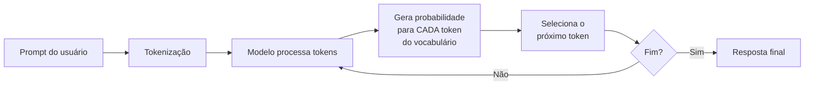
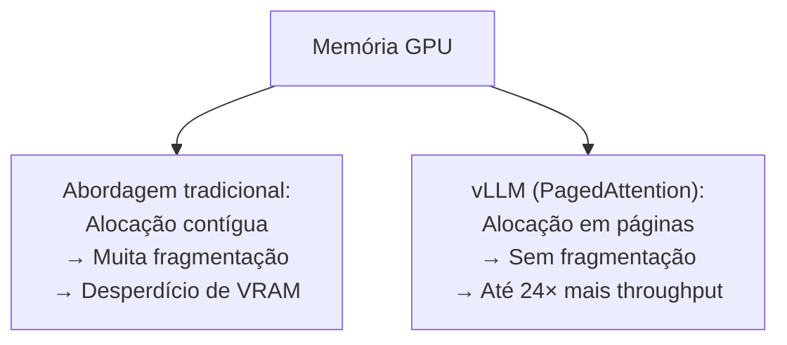
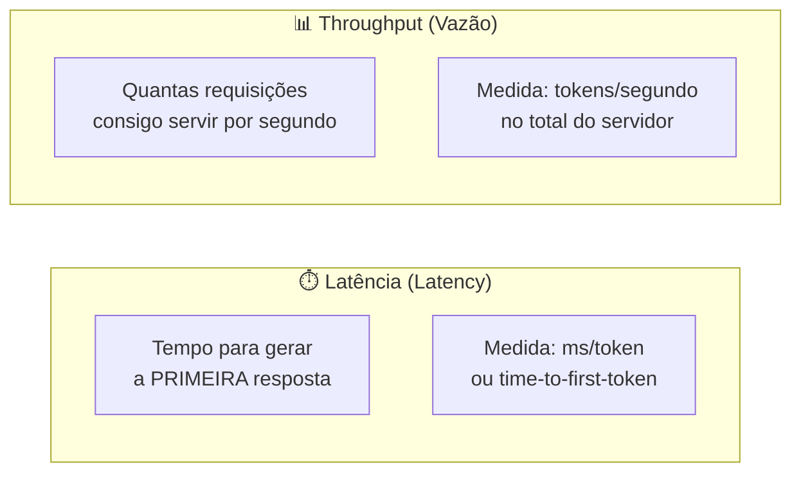

# LLMs e Inference Engines — Guia Educacional Completo

---

## 1. O que é um LLM?

**LLM** = *Large Language Model* (Modelo de Linguagem de Grande Escala).

É uma rede neural com bilhões de parâmetros (pesos numéricos) treinada para prever **o próximo token** de uma sequência de texto.

### O que é um "token"?

Token é a unidade mínima de texto que o modelo processa. Não é exatamente uma palavra — é um pedaço de texto que o **tokenizer** do modelo gera.

| Texto original | Tokens (exemplo) |
|---|---|
| `"Inteligência artificial"` | `["Int", "elig", "ência", " artificial"]` |
| `"Hello world"` | `["Hello", " world"]` |
| `"GPT-4"` | `["G", "PT", "-", "4"]` |

Cada token vira um **número** (ID). O modelo trabalha exclusivamente com números.

### O que são os "pesos" do modelo?

Quando você baixa um modelo como o **Llama 3 70B**, está baixando um arquivo (ou vários) com **70 bilhões de números de ponto flutuante**. Esses números são as "sinapses" da rede neural — eles foram ajustados durante o treinamento para que o modelo consiga gerar texto coerente.

```
Arquivo do modelo ≈ matriz gigante de números

Exemplo simplificado:
[0.0023, -1.4521, 0.8834, 0.0012, -0.5567, ...]  × 70.000.000.000
```

> [!IMPORTANT]
> O modelo em si é **inerte** — é apenas um arquivo de dados. Ele não "pensa" sozinho. Precisa de um **software** que leia esses pesos, carregue na memória e execute a matemática (multiplicações de matrizes) para gerar texto. Esse software é o **Inference Engine**.

---

## 2. Como a geração de texto funciona?

O processo de gerar texto é chamado de **inferência** (inference). Funciona assim:



### Passo a passo:

1. **Tokenização**: o texto de entrada é quebrado em tokens (IDs numéricos)
2. **Forward pass**: os tokens passam por todas as camadas da rede neural (atenção, feed-forward, normalização...)
3. **Logits → Probabilidades**: a última camada produz um vetor com a probabilidade de **cada token do vocabulário** ser o próximo
4. **Sampling**: um token é escolhido (com base em temperatura, top-p, top-k, etc.)
5. **Repetição**: o token gerado é adicionado à sequência e o processo volta ao passo 2
6. **Parada**: o loop para quando o modelo gera um token especial de fim (`<eos>`) ou atinge o limite de tokens

> [!NOTE]
> Cada "seta" (`→`) no diagrama original representa um **token sendo gerado**. É por isso que a geração é **sequencial** — o modelo gera **um token por vez**, e cada novo token depende de todos os anteriores.

### Duas fases da inferência

| Fase | O que acontece | Custo |
|---|---|---|
| **Prefill** (prompt processing) | Todos os tokens do prompt são processados **em paralelo** | Alto uso de GPU, mas rápido |
| **Decode** (geração) | Tokens são gerados **um por vez**, sequencialmente | Mais lento, limitado pela latência de memória |

Essa distinção é crucial para entender por que diferentes engines otimizam coisas diferentes.

---

## 3. O que é um Inference Engine?

É o **software que executa o modelo**. Ele é responsável por:

- 📂 **Carregar** os pesos do modelo na memória (RAM / VRAM da GPU)
- 🔢 **Executar** as operações matemáticas (multiplicação de matrizes, softmax, etc.)
- ⚡ **Otimizar** a velocidade e o uso de memória
- 🌐 **Servir** o modelo via API (em muitos casos)

### Analogia detalhada

| Conceito LLM | Analogia com Jogos |
|---|---|
| Modelo (pesos) | O jogo em si (assets, código) |
| Inference Engine | O motor gráfico (Unreal, Unity) |
| GPU/CPU | O hardware (placa de vídeo, processador) |
| Quantização | Reduzir a qualidade gráfica para rodar em hardware fraco |
| Tokens gerados | Frames renderizados |

---

## 4. Os Inference Engines em detalhe

### 🔵 llama.cpp

- **Criador**: Georgi Gerganov (projeto open-source)
- **Linguagem**: C/C++ puro
- **Foco**: Rodar LLMs **localmente**, em hardware comum

**Como funciona:**
- Carrega modelos no formato **GGUF** (formato otimizado para CPU)
- Suporta **quantização** agressiva (Q4, Q5, Q8) para reduzir o tamanho do modelo
- Roda em **CPU**, Apple Silicon (Metal), e GPUs (CUDA, Vulkan)

**Exemplo prático:**
```
Llama 3 70B em FP16 = ~140 GB de VRAM ❌ (não cabe na maioria das GPUs)
Llama 3 70B em Q4_K_M = ~40 GB de RAM ✅ (cabe num Mac com 64GB)
```

**Quando usar:** Uso pessoal, experimentação local, hardware limitado.

> [!TIP]
> O **Ollama** é basicamente um wrapper amigável em cima do llama.cpp. Quando você roda `ollama run llama3`, ele está usando llama.cpp por baixo.

---

### 🔴 vLLM (Virtual LLM)

- **Criador**: UC Berkeley
- **Linguagem**: Python + CUDA kernels
- **Foco**: Máximo **throughput** (vazão) em servidores de produção

**Inovação principal: PagedAttention**

O maior gargalo de servir LLMs é a **KV Cache** — uma memória que guarda os cálculos de atenção dos tokens já processados. O vLLM aplica o conceito de **memória virtual paginada** (do sistema operacional) à KV Cache:



**Outras otimizações:**
- **Continuous batching**: ao invés de esperar um batch inteiro terminar, novas requisições entram assim que slots ficam livres
- **Tensor parallelism**: divide o modelo entre múltiplas GPUs
- **Speculative decoding**: usa um modelo menor para "chutar" vários tokens e o modelo grande só valida

**Quando usar:** Servir LLMs em produção para muitos usuários simultâneos.

---

### 🟡 SGLang

- **Criador**: LMSYS (mesmo grupo do Chatbot Arena)
- **Linguagem**: Python
- **Foco**: **Programação estruturada** de LLMs + backend de inferência rápido

**O que tem de especial:**

SGLang ("Structured Generation Language") permite programar fluxos complexos com LLMs de forma eficiente:

```python
# Exemplo conceitual de SGLang
@sgl.function
def multi_step_reasoning(s, question):
    s += sgl.user(question)
    s += sgl.assistant(sgl.gen("thought", max_tokens=256))
    s += sgl.user("Now give the final answer in one word.")
    s += sgl.assistant(sgl.gen("answer", max_tokens=16))
```

**Otimizações do backend:**
- **RadixAttention**: reutiliza a KV cache entre requisições que compartilham prefixos
- Muito eficiente para cenários com **system prompts** longos e repetidos

**Quando usar:** Quando você precisa de pipelines multi-step com LLMs e quer performance.

---

### 🟢 TensorRT-LLM

- **Criador**: NVIDIA
- **Linguagem**: C++ / Python
- **Foco**: **Performance máxima** em GPUs NVIDIA

**Como funciona:**
1. Você **compila** o modelo para um formato otimizado (engine TensorRT)
2. O compilador aplica otimizações específicas para a sua GPU:
   - **Kernel fusion**: combina operações para reduzir acessos à memória
   - **Quantização FP8/INT8** com calibração
   - **Flash Attention** otimizado para Tensor Cores

**Trade-off:**
- ✅ Performance geralmente é a melhor possível em NVIDIA
- ❌ Setup mais complexo, compilação demorada, menos flexível
- ❌ Só funciona em GPUs NVIDIA

**Quando usar:** Produção em grande escala com GPUs NVIDIA onde cada milissegundo de latência importa.

---

### 🟣 HuggingFace TGI (Text Generation Inference)

- **Criador**: Hugging Face
- **Linguagem**: Rust + Python
- **Foco**: **Facilidade de uso** + performance razoável

**Como funciona:**
- Roda modelos diretamente do HuggingFace Hub
- API compatível com OpenAI
- Suporta continuous batching, tensor parallelism, quantização

```bash
# Subir um modelo com TGI é simples:
docker run --gpus all \
  ghcr.io/huggingface/text-generation-inference \
  --model-id meta-llama/Llama-3-70B-Instruct
```

**Quando usar:** Quando você quer deploy rápido sem muita configuração.

---

## 5. Conceitos-chave para entender as diferenças

### Latência vs Throughput



| Cenário | Prioridade |
|---|---|
| Chatbot com 1 usuário | **Latência** (o usuário quer resposta rápida) |
| API servindo 10.000 usuários | **Throughput** (servir o máximo possível) |
| Geração de código em IDE | **Latência** (completar enquanto o dev digita) |
| Processamento batch de documentos | **Throughput** (processar o máximo no menor tempo) |

### Quantização

Reduzir a **precisão numérica** dos pesos para usar menos memória:

| Precisão | Bits por peso | Tamanho (modelo 70B) | Qualidade |
|---|---|---|---|
| FP32 | 32 bits | ~280 GB | Referência |
| FP16 / BF16 | 16 bits | ~140 GB | Praticamente igual |
| INT8 | 8 bits | ~70 GB | Perda mínima |
| INT4 (Q4) | 4 bits | ~35 GB | Perda noticeable em tarefas complexas |

### KV Cache

Durante a geração, o modelo precisa "lembrar" dos tokens anteriores. A KV Cache armazena esses dados para não recalcular tudo a cada novo token.

- **Problema**: a KV Cache cresce linearmente com o tamanho do contexto
- **Exemplo**: Llama 3 70B com contexto de 128K tokens → a KV cache pode ocupar **dezenas de GB** de VRAM
- **Solução dos engines**: PagedAttention (vLLM), RadixAttention (SGLang), etc.

---

## 6. Resumo Comparativo

| Engine | Performance | Facilidade | Hardware | Melhor para |
|---|---|---|---|---|
| **llama.cpp** | ⭐⭐⭐ | ⭐⭐⭐⭐⭐ | CPU, Mac, GPU | Uso local/pessoal |
| **vLLM** | ⭐⭐⭐⭐ | ⭐⭐⭐⭐ | GPU NVIDIA/AMD | Produção alto throughput |
| **SGLang** | ⭐⭐⭐⭐⭐ | ⭐⭐⭐ | GPU NVIDIA | Pipelines complexos |
| **TensorRT-LLM** | ⭐⭐⭐⭐⭐ | ⭐⭐ | GPU NVIDIA (só) | Performance máxima |
| **HuggingFace TGI** | ⭐⭐⭐ | ⭐⭐⭐⭐⭐ | GPU NVIDIA/AMD | Deploy rápido |

---

## 7. O "System" do diagrama

O diagrama mostra que o **conjunto Inference Engine + Hardware** forma o **System** — o sistema completo que faz o modelo funcionar. O modelo é agnóstico ao engine: os mesmos pesos do Llama 3 podem rodar em qualquer um dos engines acima. A escolha do engine depende do seu **caso de uso, hardware disponível e requisitos de performance**.
