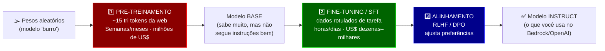
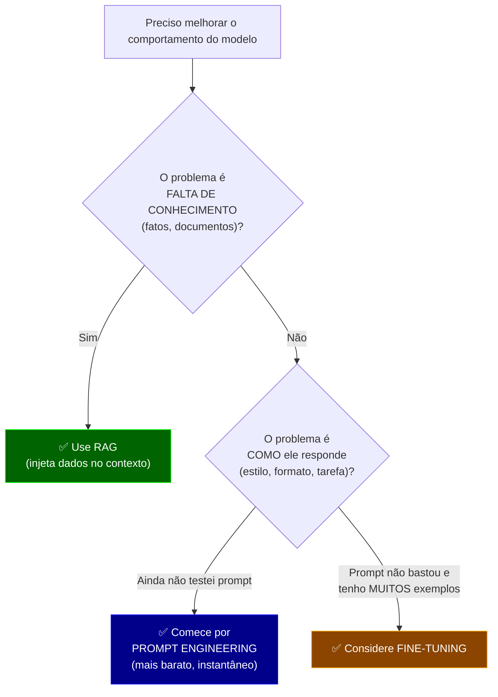

# 🏋️ Treinamento de IA e Fine-Tuning — Guia Didático

> O que significa "treinar" um modelo, quais são as grandes fases (pré-treinamento →
> fine-tuning → alinhamento), quando o fine-tuning vale a pena (e quando **não** vale),
> as técnicas modernas (LoRA/QLoRA) e como fazer isso na AWS (Bedrock e SageMaker),
> com exemplos de código por alto. Foco AWS, citando o ecossistema open-source.

---

## A Resposta Curta

**Sim, fine-tuning é uma forma de treinamento — mas é só uma parte.**

"Treinar IA" é um guarda-chuva com três grandes fases:

1. **Pré-treinamento** — criar o modelo do zero, do ruído aleatório à fluência. Custa milhões, leva meses. **Quase ninguém faz isso.**
2. **Fine-tuning** — pegar um modelo já pronto e **adaptá-lo** a um domínio/tarefa/estilo. Custa de dezenas a milhares de dólares. **É aqui que a maioria atua.**
3. **Alinhamento** — ajustar o modelo para seguir instruções e preferências humanas (SFT, RLHF, DPO). Parte disso já vem feita nos modelos "instruct".

> [!IMPORTANT]
> Antes de pensar em fine-tuning, pergunte: **eu preciso mesmo treinar?** Na maioria dos casos, **prompt engineering + RAG resolvem** com muito menos custo e complexidade. Fine-tuning é a última ferramenta, não a primeira.

---

## Índice

1. [Recapitulando: o que é "treinar"](#1-recapitulando-o-que-é-treinar)
2. [As três fases do treinamento](#2-as-três-fases-do-treinamento)
3. [Onde o fine-tuning entra](#3-onde-o-fine-tuning-entra)
4. [A pergunta-chave: fine-tuning, RAG ou prompt?](#4-a-pergunta-chave-fine-tuning-rag-ou-prompt)
5. [Tipos de fine-tuning (full, LoRA, QLoRA)](#5-tipos-de-fine-tuning-full-lora-qlora)
6. [Dados: o que faz ou quebra um fine-tuning](#6-dados-o-que-faz-ou-quebra-um-fine-tuning)
7. [Fine-tuning na AWS (Bedrock e SageMaker)](#7-fine-tuning-na-aws-bedrock-e-sagemaker)
8. [Ecossistema open-source (por alto)](#8-ecossistema-open-source-por-alto)
9. [Custos e quando NÃO fazer](#9-custos-e-quando-não-fazer)
10. [Como isso se conecta ao resto da coletânea](#10-como-isso-se-conecta-ao-resto-da-coletânea)
11. [Glossário](#11-glossário)
12. [Resumo em uma frase](#resumo-em-uma-frase)

---

## 1. Recapitulando: o que é "treinar"

Se você leu [O Que Significa "O Modelo Aprendeu"](./01-o-que-significa-aprender.md), já tem a base:
treinar = **ajustar bilhões de pesos (números)** via gradiente descendente até o modelo errar menos na previsão do próximo token.

A diferença entre as fases de treinamento **não é o mecanismo** (é sempre o mesmo loop de ajuste de pesos), e sim **com quais dados, quanto do modelo você mexe, e com que objetivo**:

```
        MESMO MECANISMO (ajustar pesos via gradiente)
                          │
      ┌───────────────────┼───────────────────┐
      ▼                   ▼                   ▼
 PRÉ-TREINO          FINE-TUNING          ALINHAMENTO
 (dados gerais,      (dados do seu        (dados de preferência
  todo o modelo,      domínio, parte       humana, ajuste fino
  do zero)            do modelo)           de comportamento)
```

---

## 2. As três fases do treinamento



### 2.1 Pré-treinamento

Cria o modelo do zero. Vê trilhões de tokens da internet e aprende linguagem, fatos e padrões. É o que custa **US$ 2M–100M+** e só grandes labs fazem (OpenAI, Anthropic, Meta, Google). O resultado é um **modelo base** — poderoso, mas "cru": ele completa texto, mas não necessariamente **segue instruções**.

### 2.2 Fine-tuning (ajuste fino)

Pega o modelo base (ou instruct) e continua o treino com **um dataset específico e menor**. O objetivo é **especializar**: um tom, um formato, um domínio (jurídico, médico), uma tarefa (classificar, extrair). Não ensina fatos novos de forma confiável — ensina **comportamento e estilo**.

### 2.3 Alinhamento (SFT → RLHF/DPO)

Transforma um modelo base em um assistente útil e seguro:

| Sigla | O que é | Em uma frase |
|---|---|---|
| **SFT** (Supervised Fine-Tuning) | Fine-tuning com pares pergunta→resposta ideais | "Aprenda a responder assim" |
| **RLHF** (RL from Human Feedback) | Humanos rankeiam respostas; treina-se um modelo de recompensa e otimiza-se com RL | "Prefira respostas que humanos gostam mais" |
| **DPO** (Direct Preference Optimization) | Alternativa mais simples ao RLHF, sem modelo de recompensa separado | "Otimize direto sobre pares preferido/rejeitado" |

> [!NOTE]
> Quando você usa `Claude`, `Nova` ou `GPT`, está usando um modelo que **já passou pelas três fases**. Você quase sempre parte de um modelo já alinhado — e, se for treinar, faz um fine-tuning por cima.

---

## 3. Onde o fine-tuning entra

Fine-tuning é a fase **2** — e, na prática, a única que a maioria das empresas realmente executa. Você **não** treina do zero; você adapta um modelo pronto.

**O que fine-tuning é bom para:**
- ✅ **Estilo/tom consistente** (ex: sempre responder no tom da marca)
- ✅ **Formato de saída rígido** (ex: sempre um JSON com estrutura X)
- ✅ **Tarefa estreita e repetitiva** (ex: classificar tickets em 12 categorias)
- ✅ **Jargão/domínio** (ex: linguagem jurídica ou médica específica)
- ✅ **Reduzir prompt** (embutir instruções longas nos pesos → prompts menores → menos custo por request)

**O que fine-tuning é RUIM para:**
- ❌ **Injetar conhecimento factual atualizável** (use RAG — ver [3.1 Bancos Vetoriais](../03-rag-dados/01-bancos-vetoriais-e-documentos.md))
- ❌ **Dados que mudam toda semana** (você teria que re-treinar sempre)
- ❌ **Casos com pouco dado** (< algumas centenas de bons exemplos costuma decepcionar)

---

## 4. A pergunta-chave: fine-tuning, RAG ou prompt?

Esta é a decisão mais importante do estudo. Erram muito aqui.



### Comparação lado a lado

| Critério | Prompt Engineering | RAG | Fine-tuning |
|---|---|---|---|
| **Serve para** | Ajuste rápido de comportamento | Conhecimento factual/atualizável | Estilo, formato, tarefa fixa |
| **Custo inicial** | ~zero | Baixo–médio (infra de vetores) | Médio–alto (treino + dados) |
| **Tempo para ter algo** | Minutos | Dias | Dias–semanas |
| **Atualiza dado novo** | Editando o prompt | Instantâneo (novo doc) | Só re-treinando ❌ |
| **Reduz custo por request** | Não (prompt grande) | Não (contexto grande) | **Sim** (prompt menor) |
| **Risco** | Baixo | Médio (qualidade do retrieval) | Alto (overfitting, esquecimento) |

> [!TIP]
> Regra prática: **Prompt primeiro → RAG se falta conhecimento → Fine-tuning só se prompt+RAG não resolvem o COMO.** Muitas vezes a resposta certa é **combinar**: um modelo com fine-tuning leve para o tom + RAG para os fatos.

---

## 5. Tipos de fine-tuning (full, LoRA, QLoRA)

O grande dilema: ajustar **todos** os pesos é caro (exige GPUs enormes). As técnicas **PEFT** (Parameter-Efficient Fine-Tuning) resolvem isso ajustando só uma fração.

```
FULL FINE-TUNING          LoRA                     QLoRA
┌──────────────┐          ┌──────────────┐         ┌──────────────┐
│ ▓▓▓▓▓▓▓▓▓▓▓▓ │          │ ░░░░░░░░░░░░ │         │ ░░(4-bit)░░░ │
│ ▓ ajusta    │          │ ░ congela   │         │ ░ congela   │
│ ▓ TODOS os  │          │ ░ o modelo  │         │ ░ +comprime │
│ ▓ pesos     │          │ ░ +treina   │         │ ░ +treina   │
│ ▓▓▓▓▓▓▓▓▓▓▓▓ │          │ ▓▓ adaptadores│        │ ▓▓ adaptadores│
└──────────────┘          └──────────────┘         └──────────────┘
 Caríssimo,               Barato, rápido,          Ainda mais barato,
 GPU gigante              1 GPU média              cabe em 1 GPU pequena
```

| Técnica | O que faz | Custo/HW | Quando usar |
|---|---|---|---|
| **Full fine-tuning** | Ajusta 100% dos pesos | Muito alto (múltiplas GPUs A100/H100) | Raro; só com muitos dados e orçamento |
| **LoRA** | Congela o modelo, treina pequenas matrizes "adaptadoras" | Baixo (1 GPU) | **Padrão moderno** para a maioria |
| **QLoRA** | LoRA + modelo quantizado em 4-bit | Muito baixo (cabe em GPU de consumo) | Quando HW é limitado |

> [!NOTE]
> A grande sacada do LoRA: em vez de mexer nos bilhões de pesos originais, você adiciona um "puxadinho" de poucos milhões de parâmetros. O resultado é um arquivo de **adaptador** de poucos MB que você acopla ao modelo base — barato de treinar, guardar e trocar.

---

## 6. Dados: o que faz ou quebra um fine-tuning

Fine-tuning é **90% dados, 10% treino**. Modelo ótimo com dados ruins = resultado ruim.

**Formato típico** (instrução → resposta, em JSONL):

```json
{"messages": [
  {"role": "system", "content": "Você é um classificador de tickets de suporte."},
  {"role": "user", "content": "Meu cartão foi cobrado duas vezes."},
  {"role": "assistant", "content": "categoria: cobrança_duplicada"}
]}
{"messages": [
  {"role": "system", "content": "Você é um classificador de tickets de suporte."},
  {"role": "user", "content": "Não consigo fazer login no app."},
  {"role": "assistant", "content": "categoria: acesso_login"}
]}
```

**Boas práticas:**

| Regra | Por quê |
|---|---|
| **Qualidade > quantidade** | 500 exemplos limpos batem 5.000 sujos |
| **Consistência de formato** | O modelo aprende o padrão que você repetir — inclusive os erros |
| **Casos difíceis e de borda** | Se todos os exemplos são fáceis, ele quebra no mundo real |
| **Separe treino/validação** | Para medir se generalizou ou apenas **decorou** (overfitting) |
| **Balanceie classes** | 90% de uma categoria → o modelo vira preguiçoso e sempre escolhe ela |

> [!CAUTION]
> **Overfitting** e **catastrophic forgetting** são os dois grandes perigos. Overfitting = o modelo decora seus exemplos e perde generalização. Catastrophic forgetting = ao aprender o novo, ele "esquece" habilidades gerais que já tinha. LoRA e datasets bem construídos reduzem ambos.

---

## 7. Fine-tuning na AWS (Bedrock e SageMaker)

A AWS oferece dois caminhos principais, do "mais gerenciado" ao "mais controlável":

```
MAIS GERENCIADO ◄─────────────────────────────► MAIS CONTROLE
┌────────────────────────┐        ┌──────────────────────────────┐
│  Amazon Bedrock         │        │  Amazon SageMaker             │
│  (Custom Models)        │        │  (training jobs próprios)     │
│                         │        │                               │
│ • Você só traz o dataset│        │ • Você controla o container,  │
│ • AWS treina e hospeda  │        │   script, hiperparâmetros     │
│ • Modelos suportados:   │        │ • Qualquer modelo HF/open     │
│   Nova, Llama, etc.     │        │ • LoRA/QLoRA à sua escolha    │
└────────────────────────┘        └──────────────────────────────┘
```

### 7.1 Bedrock — Custom Models (o caminho fácil)

Você sobe o dataset (JSONL) no S3 e dispara um job. A AWS cuida de tudo e no fim você tem um modelo customizado servido via **Provisioned Throughput**.

```python
import boto3

bedrock = boto3.client("bedrock", region_name="us-east-1")

# Dispara um job de fine-tuning (customization) no Bedrock — visão por alto
resp = bedrock.create_model_customization_job(
    jobName="classificador-tickets-v1",
    customModelName="tickets-nova-lite-v1",
    roleArn="arn:aws:iam::<conta>:role/BedrockCustomizationRole",
    baseModelIdentifier="amazon.nova-lite-v1:0",   # modelo base suportado
    customizationType="FINE_TUNING",               # ou CONTINUED_PRE_TRAINING
    trainingDataConfig={"s3Uri": "s3://meu-bucket/treino.jsonl"},
    validationDataConfig={
        "validators": [{"s3Uri": "s3://meu-bucket/validacao.jsonl"}]
    },
    outputDataConfig={"s3Uri": "s3://meu-bucket/saida/"},
    hyperParameters={
        "epochCount": "2",
        "batchSize": "1",
        "learningRate": "0.00001",
    },
)
print(resp["jobArn"])
```

> [!NOTE]
> Nomes de modelos base, hiperparâmetros aceitos e tipos de customização mudam com o tempo e por região. Trate o código acima como **esqueleto conceitual** e confira a doc oficial do Bedrock antes de rodar. Para **servir** o modelo customizado, o Bedrock geralmente exige **Provisioned Throughput** (capacidade reservada, que tem custo por hora — ver seção 9).

### 7.2 SageMaker — training job com LoRA (o caminho flexível)

Quando você quer usar um modelo open-source (ex: Llama, Mistral) e controlar o treino com LoRA/QLoRA, o SageMaker é o lugar. A ideia por alto:

```python
from sagemaker.huggingface import HuggingFace

# Um "training job": a AWS sobe uma GPU, roda seu train.py e desliga ao fim
estimator = HuggingFace(
    entry_point="train.py",          # seu script com LoRA (peft + transformers)
    source_dir="./scripts",
    instance_type="ml.g5.2xlarge",   # 1 GPU — suficiente p/ LoRA/QLoRA em modelos médios
    instance_count=1,
    transformers_version="4.36",
    pytorch_version="2.1",
    py_version="py310",
    hyperparameters={
        "model_id": "meta-llama/Llama-3.1-8B",
        "epochs": 3,
        "lora_r": 16,                # "tamanho" do adaptador LoRA
        "learning_rate": 2e-4,
    },
    role="arn:aws:iam::<conta>:role/SageMakerRole",
)

# Aponta para os dados no S3 e inicia
estimator.fit({"train": "s3://meu-bucket/treino/"})
```

E o coração do `train.py` (LoRA via biblioteca `peft`), **bem por alto**:

```python
from peft import LoraConfig, get_peft_model
from transformers import AutoModelForCausalLM

model = AutoModelForCausalLM.from_pretrained("meta-llama/Llama-3.1-8B")

# Congela o modelo e adiciona adaptadores LoRA (só eles serão treinados)
lora = LoraConfig(r=16, lora_alpha=32, target_modules=["q_proj", "v_proj"],
                  lora_dropout=0.05, task_type="CAUSAL_LM")
model = get_peft_model(model, lora)

model.print_trainable_parameters()
# Ex.: "trainable params: 4.2M || all params: 8.0B || trainable%: 0.05"
#      ↑ você treina 0,05% dos pesos — daí ser tão mais barato
```

> [!TIP]
> Repare no `trainable%: 0.05`. Essa é a mágica do PEFT/LoRA: um resultado próximo do full fine-tuning treinando uma fração mínima dos pesos — cabe em **1 GPU** em vez de um cluster.

---

## 8. Ecossistema open-source (por alto)

Fora da AWS gerenciada, o mundo open-source é onde a maioria dos experimentos acontece:

| Ferramenta | Para que serve |
|---|---|
| **Hugging Face `transformers` + `peft` + `trl`** | Bibliotecas base para treinar/fine-tunar (SFT, LoRA, DPO) |
| **Axolotl** | "Wrapper" por config YAML — fine-tuning sem escrever muito código |
| **Unsloth** | Fine-tuning otimizado (mais rápido, menos memória — ótimo p/ QLoRA) |
| **LLaMA-Factory** | Interface unificada para fine-tunar dezenas de modelos |

Todos rodam em qualquer GPU — inclusive em **serverless GPU** (Modal, RunPod), tema do
doc [4.3 Serverless GPU](../04-infraestrutura/03-serverless-gpu.md), útil quando você quer
treinar/servir sem manter GPU ligada o tempo todo.

---

## 9. Custos e quando NÃO fazer

### Ordens de grandeza (ilustrativas)

| Item | Ordem de grandeza |
|---|---|
| Pré-treino do zero | US$ 2M – 100M+ (**não faça**) |
| Fine-tuning LoRA (modelo médio, SageMaker, 1 GPU) | US$ 10 – 300 por rodada de treino |
| Fine-tuning no Bedrock (job) | Cobrado por token treinado + armazenamento |
| **Servir** modelo custom no Bedrock (Provisioned Throughput) | **US$/hora reservado** — pode dominar o custo se o tráfego for baixo |

> [!CAUTION]
> O custo escondido raramente é o **treino** — é **servir**. Um modelo customizado no Bedrock costuma exigir throughput provisionado (capacidade paga por hora, ligada ou não). Se seu volume é baixo, isso pode custar **mais** do que só usar um modelo pronto com um bom prompt. Sempre confirme na [Calculadora AWS](https://calculator.aws).

### Quando NÃO fazer fine-tuning

- ❌ Você ainda **não tentou prompt engineering** a sério.
- ❌ O problema é **falta de conhecimento** → isso é RAG.
- ❌ Você tem **poucos dados** (< algumas centenas de bons exemplos).
- ❌ Seus dados **mudam com frequência** (re-treinar toda hora é insustentável).
- ❌ O **volume de requests é baixo** (o custo de servir não compensa).

---

## 10. Como isso se conecta ao resto da coletânea

```
 Módulo 1 (você está aqui)
   ├─ o-que-significa-aprender ──► base: o que é ajustar pesos
   └─ ESTE DOC ──────────────────► as fases; fine-tuning como adaptação

        │ o modelo (com ou sem fine-tuning) é usado pelo...
        ▼
 Módulo 2 — ORQUESTRAÇÃO ──► o orquestrador chama o modelo
        │                     (o roteador 2.6 pode escolher entre
        │                      modelo base vs. modelo fine-tunado)
        ▼
 Módulo 3 — RAG ────────────► a alternativa ao fine-tuning p/ CONHECIMENTO
        ▼
 Módulo 4 — INFRA ──────────► onde o treino/serviço roda (SageMaker,
        │                     serverless GPU)
        ▼
 Módulo 5 — GOVERNANÇA ─────► custo de treinar e de servir (throughput)
```

- Se o problema é **conhecimento** → volte ao [Módulo 3 (RAG)](../03-rag-dados/01-bancos-vetoriais-e-documentos.md).
- Se o problema é **escolher o modelo certo por request** (base vs. fine-tunado) → [2.6 Roteamento](../02-orquestracao/06-roteamento-de-llms.md).
- Se o problema é **onde rodar o treino sem GPU ligada 24/7** → [4.3 Serverless GPU](../04-infraestrutura/03-serverless-gpu.md).
- Se o problema é **quanto custa servir o modelo custom** → [5.1 Precificação e Governança](../05-governanca-seguranca/01-precificacao-tokens-credenciais-aws.md).

---

## 11. Glossário

| Termo | Significado |
|---|---|
| **Modelo base** | Modelo só pré-treinado; completa texto mas não segue instruções bem |
| **Modelo instruct** | Modelo base + alinhamento; o que você usa no dia a dia |
| **Epoch** | Uma passada completa pelo dataset de treino |
| **Learning rate** | Tamanho do "passo" de ajuste dos pesos |
| **SFT** | Supervised Fine-Tuning: treino com pares pergunta→resposta ideais |
| **RLHF** | Reinforcement Learning from Human Feedback |
| **DPO** | Direct Preference Optimization (alternativa mais simples ao RLHF) |
| **PEFT** | Parameter-Efficient Fine-Tuning (treinar só uma fração dos pesos) |
| **LoRA** | Técnica PEFT com adaptadores de baixo posto (low-rank) |
| **QLoRA** | LoRA sobre modelo quantizado em 4-bit (menos memória) |
| **Overfitting** | Modelo "decora" o treino e perde generalização |
| **Catastrophic forgetting** | Modelo esquece habilidades antigas ao aprender o novo |
| **Provisioned Throughput** | Capacidade reservada (paga por hora) para servir modelos no Bedrock |

---

## Resumo em uma frase

> **Treinar IA tem três fases — pré-treino (criar do zero), fine-tuning (adaptar um modelo pronto) e alinhamento (ajustar comportamento); fine-tuning é a parte que você provavelmente faria, mas só depois de esgotar prompt engineering e RAG, usando LoRA/QLoRA para caber em uma GPU, sabendo que o maior custo costuma ser servir o modelo, não treiná-lo.**
