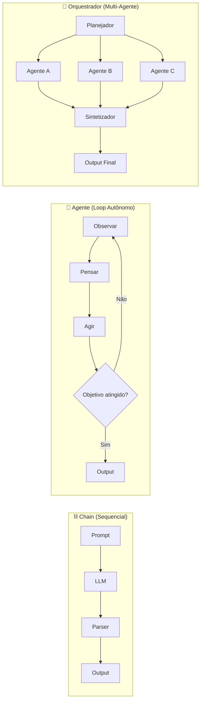
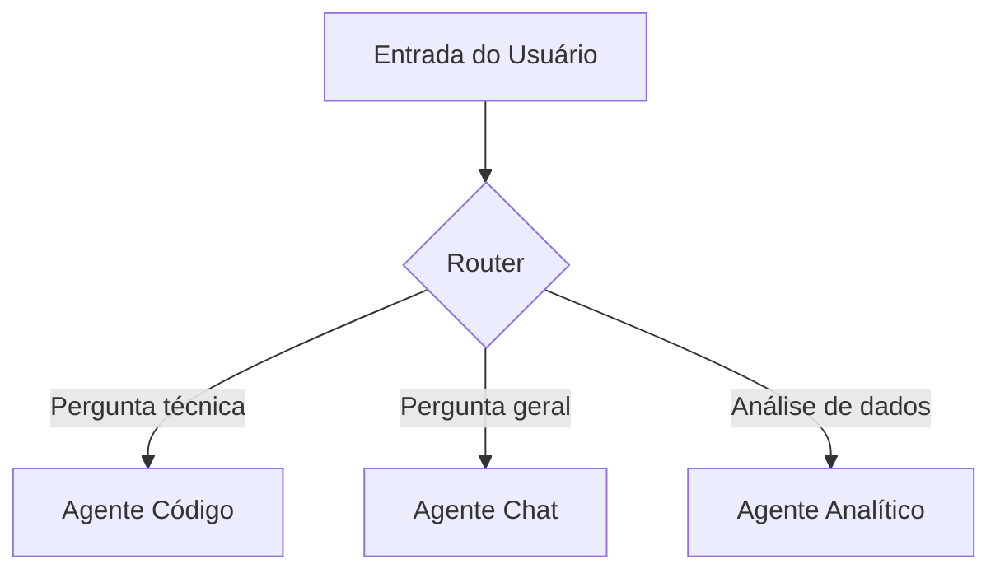
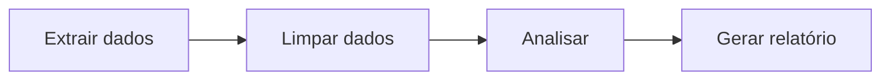
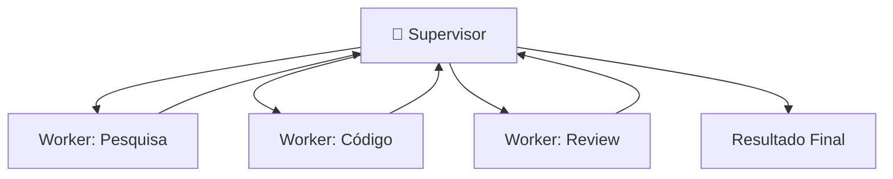
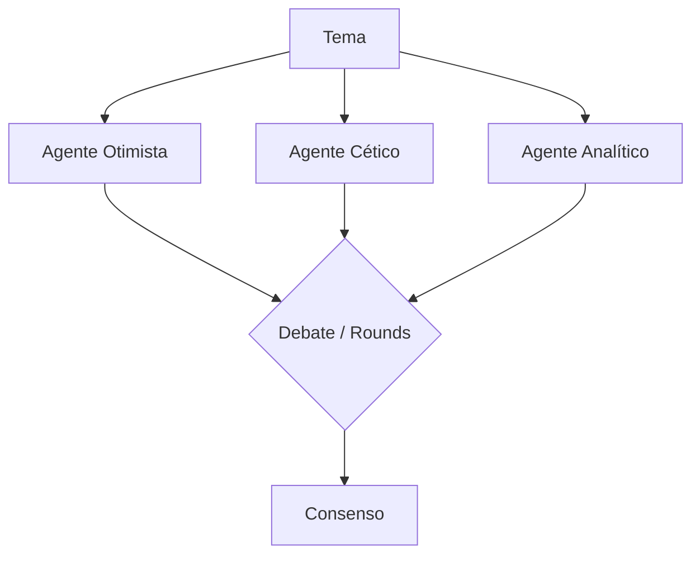
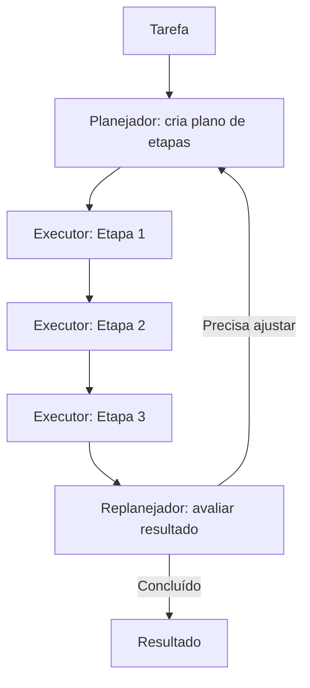
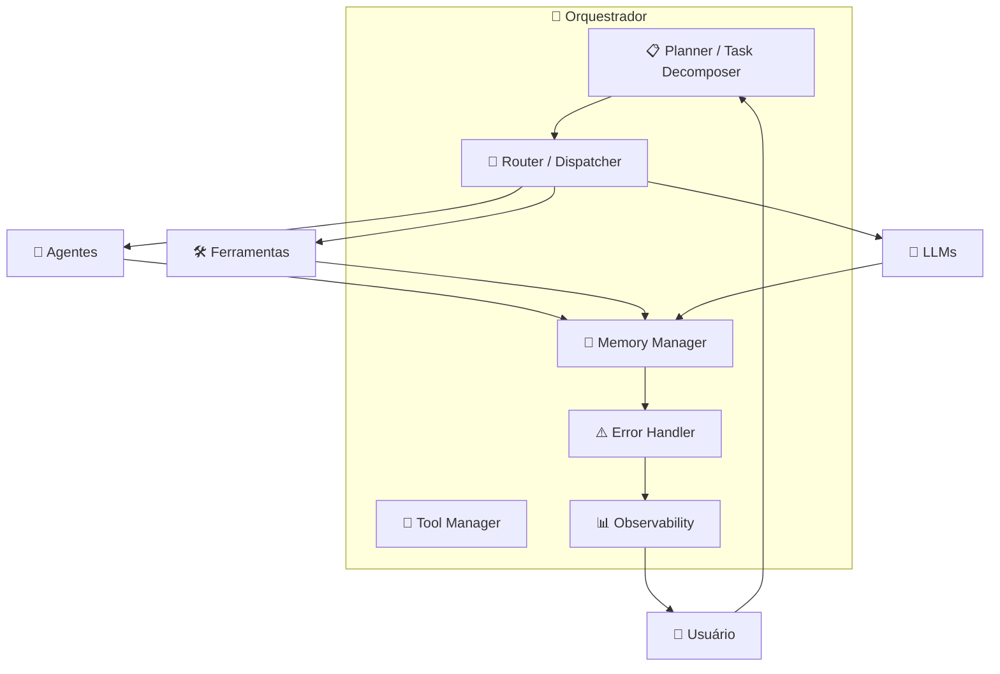
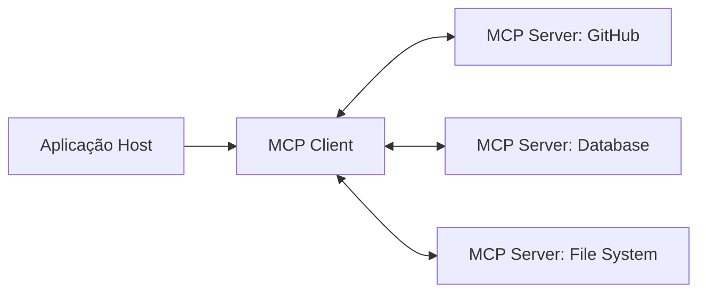
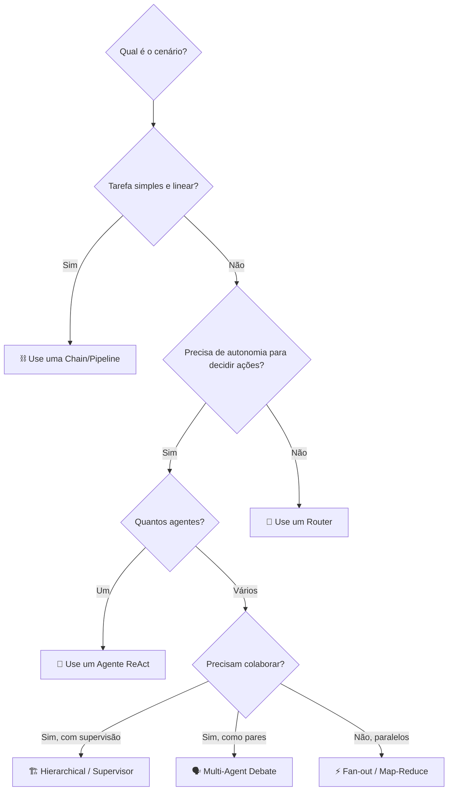
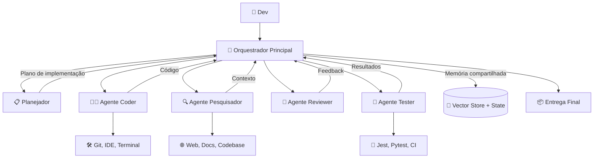

# 🧠 Orquestradores de IA — Estudo Didático

## 1. O que é um Orquestrador de IA?

Um **orquestrador de IA** é uma camada de software que **coordena, roteia e gerencia** a interação entre múltiplos componentes de um sistema de IA — incluindo modelos de linguagem (LLMs), ferramentas externas, memória, bancos de dados e APIs — para cumprir tarefas complexas que um único modelo não conseguiria resolver sozinho.

> [!TIP]
> **Analogia**: Pense em um orquestrador como um **maestro de orquestra**. Cada instrumento (LLM, ferramenta, banco de dados) toca sua parte, mas é o maestro que decide *quem toca*, *quando*, *em que ordem* e *como as partes se combinam* para produzir a sinfonia final.

---

## 2. Por que precisamos de Orquestradores?

| Problema | Sem Orquestrador | Com Orquestrador |
|---|---|---|
| **Tarefas complexas** | LLM tenta resolver tudo sozinho, alucinando | Decompõe em subtarefas especializadas |
| **Uso de ferramentas** | Integração manual e frágil | Roteamento automático para a ferramenta certa |
| **Memória** | Limitado à janela de contexto | Memória de curto e longo prazo gerenciada |
| **Confiabilidade** | Erros propagam sem controle | Retry, fallback e validação embutidos |
| **Multi-modelo** | Locked-in a um único provider | Roteia para o modelo ideal por tarefa |
| **Observabilidade** | Caixa preta | Logs, traces, métricas de cada etapa |

---

## 3. Conceitos Fundamentais

### 3.1 Agentes vs. Chains vs. Orquestradores



| Conceito | Definição | Exemplo |
|---|---|---|
| **Chain** | Sequência fixa de etapas (prompt → LLM → parser) | Traduzir texto e resumir |
| **Agente** | Loop autônomo que decide suas próprias ações | Agente que pesquisa na web até achar a resposta |
| **Orquestrador** | Coordena múltiplos agentes/chains/ferramentas | Sistema que planeja, pesquisa, codifica e testa |

### 3.2 Padrões Arquiteturais

#### 🔀 Padrão 1: Router (Roteador)

Direciona a entrada para o agente/chain mais adequado.



**Quando usar**: Quando diferentes tipos de input requerem tratamentos distintos.

---

#### 🔗 Padrão 2: Sequential Chain (Pipeline)

Cada etapa alimenta a próxima em sequência.



**Quando usar**: Quando as etapas são determinísticas e cada uma depende da anterior.

---

#### 🌳 Padrão 3: Hierarchical (Supervisor)

Um agente supervisor delega tarefas para agentes trabalhadores.



**Quando usar**: Tarefas complexas que requerem especialização.

---

#### 🗣️ Padrão 4: Multi-Agent Debate

Agentes com perspectivas diferentes debatem até convergir.



**Quando usar**: Decisões que se beneficiam de múltiplas perspectivas.

---

#### 🔄 Padrão 5: Plan-and-Execute

Separa planejamento de execução.



**Quando usar**: Tarefas que exigem raciocínio em múltiplas etapas e possível replanejamento.

---

## 4. Componentes de um Orquestrador



### Detalhamento dos Componentes

| Componente | Responsabilidade | Exemplo Prático |
|---|---|---|
| **Planner** | Decompõe tarefas complexas em subtarefas | "Construir API" → [modelar, codificar, testar, documentar] |
| **Router** | Decide qual agente/tool usar | Classificar intent → direcionar para o agente certo |
| **Memory Manager** | Gerencia contexto de curto/longo prazo | Histórico de conversas, knowledge base vetorial |
| **Tool Manager** | Registra e invoca ferramentas externas | Buscar no Google, executar SQL, chamar APIs |
| **Error Handler** | Trata falhas com retry/fallback | Se API X falhar, tentar API Y |
| **Observability** | Logs, tracing, métricas | Latência por etapa, tokens consumidos, custo |

---

## 5. Principais Frameworks e Ferramentas

### 5.1 Comparativo Geral

| Framework | Empresa | Linguagem | Foco Principal | Maturidade |
|---|---|---|---|---|
| **LangChain / LangGraph** | LangChain Inc. | Python/JS | Chains, agentes, grafos de estado | ⭐⭐⭐⭐⭐ |
| **CrewAI** | CrewAI | Python | Multi-agente com "roles" | ⭐⭐⭐⭐ |
| **AutoGen** | Microsoft | Python | Conversação multi-agente | ⭐⭐⭐⭐ |
| **Semantic Kernel** | Microsoft | C#/Python/Java | Enterprise, integração Microsoft | ⭐⭐⭐⭐ |
| **Haystack** | deepset | Python | RAG e pipelines documentais | ⭐⭐⭐⭐ |
| **DSPy** | Stanford NLP | Python | Programação declarativa de LLM | ⭐⭐⭐ |
| **OpenAI Agents SDK** | OpenAI | Python | Agentes nativos OpenAI | ⭐⭐⭐⭐ |
| **Google ADK** | Google | Python | Agentes com ecossistema Google | ⭐⭐⭐ |
| **Mastra** | Mastra | TypeScript | Framework agnóstico TS-first | ⭐⭐⭐ |

---

### 5.2 Deep Dive por Framework

#### 🦜 LangChain / LangGraph

**O que é**: O ecossistema mais popular para construir aplicações com LLMs. LangChain oferece chains e agentes; **LangGraph** adiciona grafos de estado cíclicos para fluxos complexos.

**Conceitos-chave**:
- **LCEL** (LangChain Expression Language): Composição declarativa de chains
- **StateGraph**: Grafo onde nós são funções e arestas são transições condicionais
- **Checkpointing**: Persistência de estado para long-running workflows

```
# Pseudocódigo LangGraph
graph = StateGraph(AgentState)
graph.add_node("research", research_agent)
graph.add_node("write", writer_agent)
graph.add_node("review", reviewer_agent)

graph.add_edge("research", "write")
graph.add_conditional_edges("review", should_continue,
    {"revise": "write", "approve": END})
```

**Prós**: Ecossistema vasto, muitas integrações, comunidade ativa
**Contras**: Complexidade crescente, abstrações às vezes excessivas

---

#### 🚢 CrewAI

**O que é**: Framework focado em **role-playing multi-agente**. Define agentes com roles, goals e backstories, organizados em "crews".

**Conceitos-chave**:
- **Agent**: Entidade com role, goal, backstory e tools
- **Task**: Unidade de trabalho com descrição e agente designado
- **Crew**: Grupo de agentes que colaboram (sequencial ou hierárquico)
- **Process**: Modo de execução (sequential, hierarchical)

```
# Pseudocódigo CrewAI
researcher = Agent(role="Pesquisador", goal="Encontrar dados relevantes")
writer = Agent(role="Escritor", goal="Redigir artigo de qualidade")

crew = Crew(
    agents=[researcher, writer],
    tasks=[research_task, writing_task],
    process=Process.sequential
)
```

**Prós**: API intuitiva, fácil de começar, boa para prototipação
**Contras**: Menos controle granular, performance em produção

---

#### 🤖 AutoGen (Microsoft)

**O que é**: Framework para construir aplicações com **múltiplos agentes conversacionais** que interagem entre si.

**Conceitos-chave**:
- **ConversableAgent**: Agente base que pode enviar/receber mensagens
- **AssistantAgent**: Agente com LLM para gerar respostas
- **UserProxyAgent**: Representa o humano, pode executar código
- **GroupChat**: Chat com múltiplos agentes e manager

```
# Pseudocódigo AutoGen
assistant = AssistantAgent("assistant", llm_config=config)
user_proxy = UserProxyAgent("user", code_execution_config={"work_dir": "output"})

user_proxy.initiate_chat(assistant, message="Analise estes dados...")
```

**Prós**: Forte em execução de código, boa para data science
**Contras**: Curva de aprendizado, debug pode ser difícil

---

#### 💎 Semantic Kernel (Microsoft)

**O que é**: SDK enterprise para integrar LLMs em aplicações existentes, com forte integração ao ecossistema Microsoft.

**Conceitos-chave**:
- **Kernel**: Orquestrador central
- **Plugins**: Coleções de funções (nativas ou de prompt)
- **Planner**: Gera plano de execução automaticamente
- **Memory**: Memória semântica com embeddings

**Prós**: Enterprise-ready, tipagem forte, integração Azure
**Contras**: Menor comunidade open-source, mais verboso

---

#### 🔑 OpenAI Agents SDK

**O que é**: SDK oficial da OpenAI para construir agentes com handoff entre agentes, guardrails e tracing nativo.

**Conceitos-chave**:
- **Agent**: Definido por instructions, model e tools
- **Handoff**: Transferência de controle entre agentes
- **Guardrails**: Validação de input/output
- **Tracing**: Observabilidade built-in

**Prós**: Integração nativa com modelos OpenAI, API limpa
**Contras**: Vendor lock-in (OpenAI), menos integrações externas

---

#### 🌐 Google Agent Development Kit (ADK)

**O que é**: Framework do Google para construir agentes com acesso ao ecossistema Google (Gemini, Search, Cloud).

**Conceitos-chave**:
- **Agent**: Agente com model, tools e sub-agents
- **Tools**: Funções Python, APIs Google, ou outros agentes
- **Sessions**: Gerenciamento de estado da conversa
- **A2A Protocol**: Comunicação inter-agentes padronizada

**Prós**: Integração Google Cloud, suporte a múltiplos modelos
**Contras**: Ecossistema mais recente, menos exemplos na comunidade

---

## 6. Protocolos e Padrões Emergentes

### 6.1 MCP — Model Context Protocol

Criado pela Anthropic, é um **protocolo aberto** para conectar LLMs a ferramentas e fontes de dados externas.



- **Padroniza** a interface entre LLM e ferramentas
- **Servidor** expõe capabilities (tools, resources, prompts)
- **Cliente** descobre e invoca essas capabilities
- **Transporte**: stdio, HTTP/SSE

### 6.2 A2A — Agent-to-Agent Protocol

Criado pelo Google, padroniza a **comunicação entre agentes** de diferentes frameworks.

- **Agent Card**: Documento JSON que descreve capacidades do agente
- **Task Lifecycle**: Criação, execução e conclusão de tarefas inter-agentes
- **Streaming**: Suporte a respostas parciais via SSE

### 6.3 Comparação MCP vs A2A

| Aspecto | MCP | A2A |
|---|---|---|
| **Foco** | LLM ↔ Ferramentas | Agente ↔ Agente |
| **Criador** | Anthropic | Google |
| **Analogia** | USB para IA | HTTP para agentes |
| **Complementar?** | ✅ Sim, atuam em camadas diferentes | ✅ Sim |

---

## 7. Decisões Arquiteturais

### 7.1 Quando usar cada padrão?



### 7.2 Checklist de Produção

- [ ] **Observabilidade**: Tracing end-to-end implementado?
- [ ] **Rate Limiting**: Controle de tokens/requisições por minuto?
- [ ] **Cost Management**: Monitoramento de custos por execução?
- [ ] **Error Handling**: Fallbacks e circuit breakers?
- [ ] **Security**: Sandboxing para execução de código? Guardrails para output?
- [ ] **Testing**: Evals automatizadas para qualidade das respostas?
- [ ] **Versioning**: Versionamento de prompts e configurações?
- [ ] **Human-in-the-Loop**: Pontos de aprovação humana para ações críticas?

---

## 8. Exemplo Conceitual Completo

### Cenário: Assistente de Desenvolvimento de Software



**Fluxo**:
1. Dev descreve a feature desejada
2. **Planejador** decompõe em subtarefas
3. **Pesquisador** busca contexto no codebase e documentação
4. **Coder** implementa seguindo o plano + contexto
5. **Reviewer** analisa o código e sugere melhorias
6. **Coder** aplica correções (loop)
7. **Tester** executa testes automatizados
8. Orquestrador entrega o resultado final

> [!NOTE]
> Este é essencialmente o padrão que ferramentas como **Cursor, Windsurf, GitHub Copilot Workspace e o próprio Antigravity** seguem internamente!

---

## 9. Tendências e Futuro (2025-2026)

| Tendência | Descrição |
|---|---|
| **Agentes como Serviço** | Plataformas que oferecem agentes especializados prontos para uso |
| **Padronização de protocolos** | MCP e A2A convergindo como padrões da indústria |
| **Computer Use** | Agentes que interagem com interfaces gráficas (tela, mouse, teclado) |
| **Long-running Agents** | Agentes que executam por horas/dias com checkpointing |
| **Multi-modal Agents** | Orquestradores que combinam texto, imagem, áudio e vídeo |
| **Self-improving Agents** | Agentes que aprendem com feedback e melhoram prompts automaticamente |
| **Agentic RAG** | RAG onde o agente decide dinamicamente o que buscar e como |

---

## 10. Glossário Rápido

| Termo | Definição |
|---|---|
| **ReAct** | Reasoning + Acting — padrão onde o agente alterna entre raciocinar e agir |
| **Tool Calling** | Capacidade do LLM de invocar funções/ferramentas externas |
| **Guardrails** | Validações que impedem comportamentos indesejados do agente |
| **Handoff** | Transferência de controle de um agente para outro |
| **Human-in-the-Loop** | Ponto onde um humano intervém para aprovar/corrigir |
| **Eval** | Avaliação automatizada da qualidade de respostas do agente |
| **Embedding** | Representação vetorial de texto para busca semântica |
| **RAG** | Retrieval-Augmented Generation — buscar contexto antes de gerar |
| **Checkpoint** | Snapshot do estado do agente para retomada posterior |
| **Fan-out/Fan-in** | Distribuir subtarefas em paralelo e agregar resultados |

---

> [!IMPORTANT]
> **Regra de ouro**: Comece simples (chain/agente único), meça os pontos de falha, e escale para multi-agente/orquestrador apenas quando a complexidade justificar. Over-engineering com agentes é tão perigoso quanto under-engineering.
