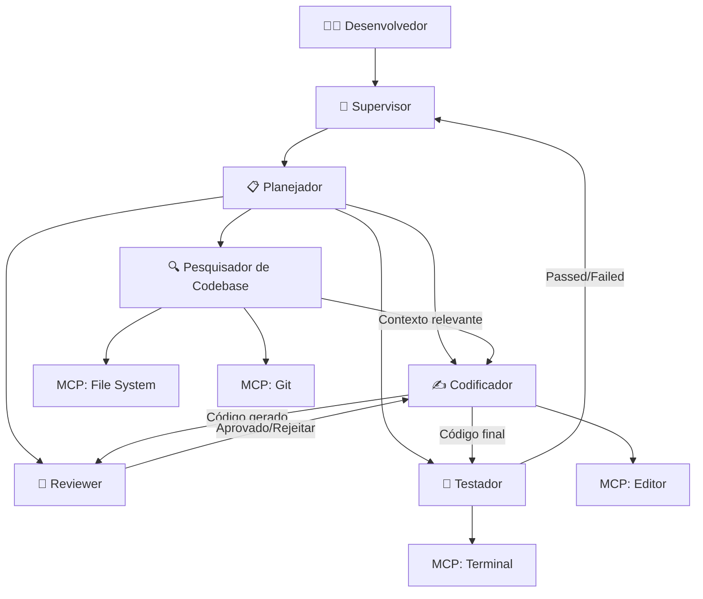
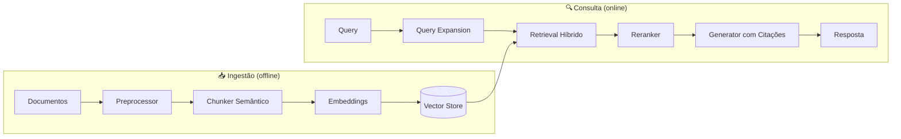
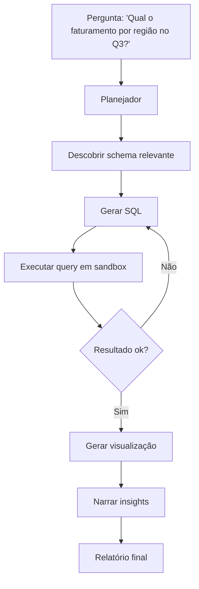
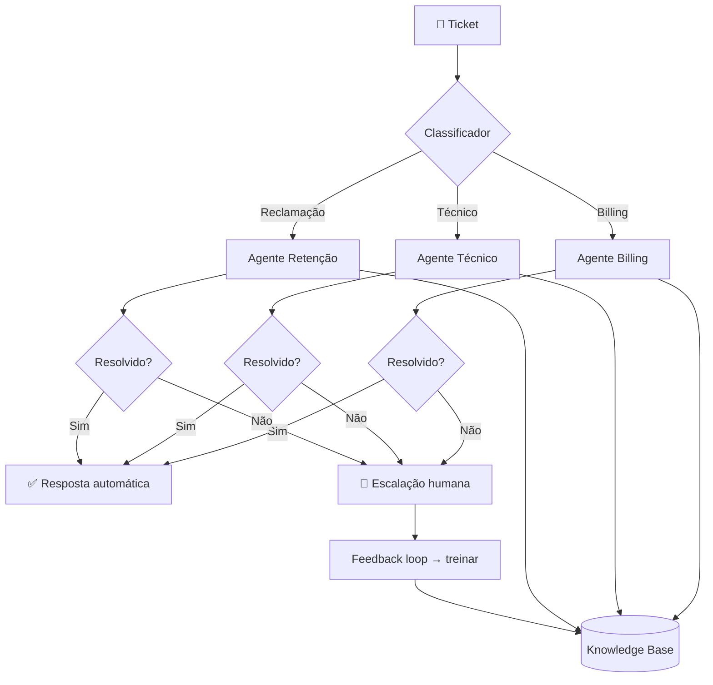
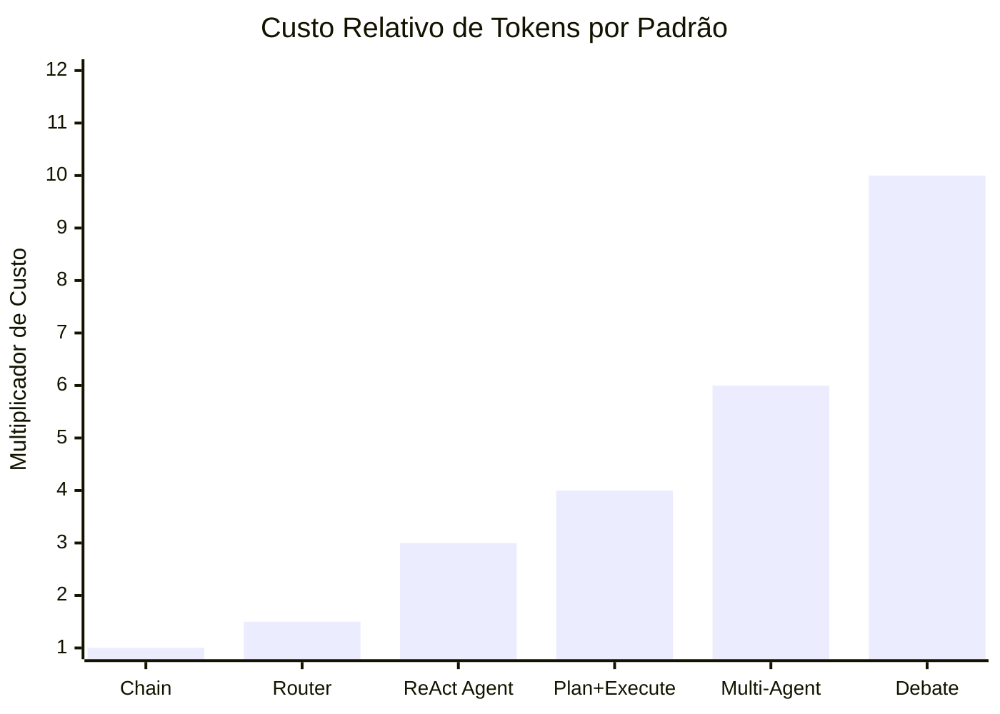
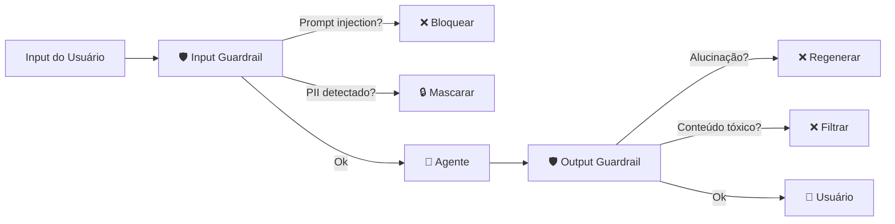
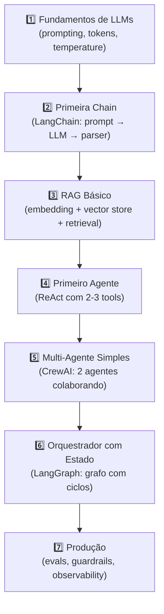

# 🚀 Orquestradores de IA como Produto — Casos de Uso, Comparações e Tendências

> Material complementar ao [estudo didático de orquestradores](01-orquestradores-estudo-didatico.md)

---

## 1. Casos de Uso de IA como Produto

### 📊 Mapa de Casos de Uso por Complexidade e Valor

```mermaid
flowchart LR
    subgraph LOW["🟢 Complexidade Baixa"]
        A1[Chatbot FAQ]
        A2[Geração de Conteúdo]
        A3[Classificação de Tickets]
    end
    subgraph MED["🟡 Complexidade Média"]
        B1[RAG Enterprise]
        B2[Code Assistant]
        B3[Customer Support Inteligente]
        B4[Automação de Processos]
    end
    subgraph HIGH["🔴 Complexidade Alta"]
        C1[Agente DevOps Autônomo]
        C2[Análise Legal / Compliance]
        C3[Pipeline de Dados com IA]
        C4[Plataforma Educacional Adaptativa]
        C5[E-commerce Personalizado]
    end

    LOW --> MED --> HIGH
```



---

### 1.1 🗣️ Chatbot Inteligente / Assistente Virtual

**O Produto**: Chatbot que vai além de FAQ — entende contexto, mantém memória da conversa, escala para múltiplos idiomas e integra com sistemas internos.

| Aspecto | Detalhe |
|---|---|
| **Padrão ideal** | Router + Chain |
| **Framework recomendado** | **LangChain** (rápido de prototipar) ou **Semantic Kernel** (enterprise) |
| **Componentes-chave** | Intent router, memória conversacional, fallback para humano |
| **Complexidade** | 🟢 Baixa a Média |
| **Time-to-Market** | 2-4 semanas (MVP) |

**Stack recomendado**:
```
Router de Intent (LLM classifier)
  ├── Chain: Perguntas frequentes (RAG simples)
  ├── Chain: Agendamento (integração calendário)
  ├── Chain: Suporte técnico (RAG + ferramentas)
  └── Fallback: Transferência para humano
```

> [!TIP]
> **Dica**: Comece com um router simples baseado em embeddings e migre para LLM classifier apenas quando a acurácia não for suficiente. Economiza ~80% em custos de API.

---

### 1.2 💻 Code Assistant / Coding Agent

**O Produto**: Assistente que entende o codebase, gera código, faz review, executa testes e cria PRs — como Cursor, GitHub Copilot Workspace ou Antigravity.

| Aspecto | Detalhe |
|---|---|
| **Padrão ideal** | Hierarchical (Supervisor) + Plan-and-Execute |
| **Framework recomendado** | **LangGraph** (flexibilidade máxima) ou **OpenAI Agents SDK** (se locked-in OpenAI) |
| **Componentes-chave** | Code indexer, AST parser, test runner, git integration, sandbox |
| **Complexidade** | 🔴 Alta |
| **Time-to-Market** | 3-6 meses |

**Arquitetura típica**:


> [!IMPORTANT]
> **Decisão crítica**: Sandboxing é obrigatório. Agentes que executam código arbitrário precisam rodar em containers isolados (Docker, Firecracker, gVisor). Nunca execute código gerado por LLM diretamente no host.

---

### 1.3 📚 RAG Enterprise (Knowledge Base)

**O Produto**: Sistema que permite buscar e consultar documentação interna, wikis, Confluence, Notion, PDFs — com respostas precisas e citações.

| Aspecto | Detalhe |
|---|---|
| **Padrão ideal** | Pipeline (ingestão) + Agente ReAct (consulta) |
| **Framework recomendado** | **Haystack** (melhor para RAG puro) ou **LangChain** (mais integrações) |
| **Componentes-chave** | Chunker, embedding model, vector store, reranker, citation generator |
| **Complexidade** | 🟡 Média |
| **Time-to-Market** | 4-8 semanas |

**Pipeline de RAG Avançado**:


**Evolução do RAG**:

| Geração | Abordagem | Qualidade |
|---|---|---|
| **RAG Naive** | Embed → busca top-k → gera | ⭐⭐ |
| **RAG com Reranker** | + reranking cross-encoder | ⭐⭐⭐ |
| **RAG Híbrido** | Semântico + keyword (BM25) | ⭐⭐⭐⭐ |
| **Agentic RAG** | Agente decide: buscar, refinar query, multi-hop | ⭐⭐⭐⭐⭐ |

> [!TIP]
> **Dica**: Não subestime o chunking. Um chunker semântico (que divide por tópicos) supera chunking por tamanho fixo em ~30% de acurácia. Use `semantic-chunkers` ou o chunker do LlamaIndex.

---

### 1.4 ⚙️ Automação de Processos (RPA Inteligente)

**O Produto**: Automação de workflows empresariais — aprovações, processamento de documentos, onboarding, relatórios — com IA para lidar com exceções.

| Aspecto | Detalhe |
|---|---|
| **Padrão ideal** | Pipeline + Router (para exceções) |
| **Framework recomendado** | **Semantic Kernel** (enterprise) ou **LangGraph** (flexível) |
| **Componentes-chave** | OCR, document parser, rules engine, human-in-the-loop |
| **Complexidade** | 🟡 Média |
| **Time-to-Market** | 6-12 semanas |

**Exemplo: Processamento de Faturas**:
```
Fatura recebida (email/upload)
  → OCR + Extração de campos (LLM)
    → Validação contra regras de negócio
      → ✅ Aprovação automática (< R$5k)
      → ⚠️ Review humano (> R$5k ou dados inconsistentes)
        → Registro no ERP
          → Notificação ao solicitante
```

---

### 1.5 📊 Data Pipeline com IA (Analytics Agent)

**O Produto**: Agente que permite fazer perguntas em linguagem natural sobre dados, gera queries SQL, cria visualizações e relatórios automaticamente.

| Aspecto | Detalhe |
|---|---|
| **Padrão ideal** | Plan-and-Execute |
| **Framework recomendado** | **AutoGen** (forte em código/dados) ou **LangGraph** |
| **Componentes-chave** | Schema discovery, text-to-SQL, chart generator, sandbox |
| **Complexidade** | 🔴 Alta |
| **Time-to-Market** | 2-4 meses |



---

### 1.6 ✍️ Plataforma de Geração de Conteúdo

**O Produto**: Sistema que gera artigos, posts, emails marketing, descrições de produto — com brand voice, SEO e multi-idioma.

| Aspecto | Detalhe |
|---|---|
| **Padrão ideal** | Pipeline (drafting) + Multi-Agent Debate (quality) |
| **Framework recomendado** | **CrewAI** (intuitivo para roles) ou **LangChain** |
| **Componentes-chave** | Brand voice embeddings, SEO analyzer, plagiarism checker, A/B tester |
| **Complexidade** | 🟢 Baixa a Média |
| **Time-to-Market** | 2-4 semanas |

**Crew típica**:
```
Crew: Content Factory
  ├── 📝 Researcher: pesquisa tendências e referências
  ├── ✍️ Writer: redige o rascunho com brand voice
  ├── 🔍 Editor: revisa gramática, tom e SEO
  ├── 🎨 Creative Director: sugere títulos e hooks
  └── ✅ Quality Checker: plagiarism + fact-checking
```

---

### 1.7 🎧 Customer Support Avançado

**O Produto**: Sistema de suporte que resolve tickets automaticamente, escala para humanos quando necessário, e aprende com resoluções anteriores.

| Aspecto | Detalhe |
|---|---|
| **Padrão ideal** | Hierarchical + Router |
| **Framework recomendado** | **OpenAI Agents SDK** (handoffs nativos) ou **LangGraph** |
| **Componentes-chave** | Ticket classifier, knowledge base RAG, sentiment analyzer, escalation engine |
| **Complexidade** | 🟡 Média a Alta |
| **Time-to-Market** | 6-10 semanas |



---

### 1.8 🏗️ Agente DevOps / SRE

**O Produto**: Agente que monitora infraestrutura, diagnostica incidentes, sugere/aplica remediações e gera post-mortems.

| Aspecto | Detalhe |
|---|---|
| **Padrão ideal** | Plan-and-Execute + Router |
| **Framework recomendado** | **LangGraph** (controle fino de estado) |
| **Componentes-chave** | Log analyzer, metric correlator, runbook executor, approval gates |
| **Complexidade** | 🔴 Alta |
| **Time-to-Market** | 3-6 meses |

> [!CAUTION]
> **Risco crítico**: Agentes DevOps que executam ações (restart, scale, deploy) DEVEM ter approval gates humanos e limites de blast radius. Um agente autônomo que dá `kubectl delete` no namespace errado pode derrubar produção.

---

### 1.9 ⚖️ Análise Legal e Compliance

**O Produto**: Sistema que analisa contratos, identifica cláusulas de risco, verifica compliance regulatório e sugere modificações.

| Aspecto | Detalhe |
|---|---|
| **Padrão ideal** | Pipeline + Multi-Agent Debate |
| **Framework recomendado** | **Haystack** (RAG documental forte) + **LangGraph** |
| **Componentes-chave** | Document parser (PDF/DOCX), clause extractor, risk scorer, regulation DB |
| **Complexidade** | 🔴 Alta |
| **Time-to-Market** | 4-8 meses |

---

### 1.10 🛒 E-commerce Personalizado

**O Produto**: Motor de recomendação e atendimento que personaliza a experiência de compra com IA conversacional.

| Aspecto | Detalhe |
|---|---|
| **Padrão ideal** | Router + Agente ReAct |
| **Framework recomendado** | **LangChain** ou **Mastra** (TypeScript para web) |
| **Componentes-chave** | Product catalog RAG, user profile, recommendation engine, cart manager |
| **Complexidade** | 🟡 Média |
| **Time-to-Market** | 4-8 semanas |

---

### 1.11 🎓 Plataforma Educacional Adaptativa

**O Produto**: Tutor de IA que adapta conteúdo ao nível do aluno, gera exercícios, corrige respostas e acompanha progresso.

| Aspecto | Detalhe |
|---|---|
| **Padrão ideal** | Hierarchical + Plan-and-Execute |
| **Framework recomendado** | **CrewAI** (roles claros) ou **LangGraph** |
| **Componentes-chave** | Learner model, curriculum planner, exercise generator, evaluator |
| **Complexidade** | 🔴 Alta |
| **Time-to-Market** | 3-6 meses |

---

### 1.12 🏥 Healthcare - Triagem e Suporte Clínico

**O Produto**: Sistema que auxilia triagem de pacientes, sumariza prontuários e sugere protocolos clínicos (sempre com supervisão médica).

| Aspecto | Detalhe |
|---|---|
| **Padrão ideal** | Pipeline + Human-in-the-Loop obrigatório |
| **Framework recomendado** | **Semantic Kernel** (enterprise, compliance) |
| **Componentes-chave** | Medical NER, protocol DB, risk assessment, audit trail completo |
| **Complexidade** | 🔴 Muito Alta |
| **Time-to-Market** | 6-12 meses |

> [!CAUTION]
> **Regulamentação**: Produtos de IA em saúde exigem conformidade com HIPAA (EUA), LGPD (Brasil), GDPR (EU). Toda decisão do agente DEVE ser auditável e com supervisão humana obrigatória.

---

## 2. Matriz de Decisão: Framework × Caso de Uso

> Scores de 1 (fraco) a 5 (excelente) para cada combinação.

| Caso de Uso | LangGraph | CrewAI | AutoGen | Semantic Kernel | Haystack | OpenAI SDK | Google ADK | Mastra |
|---|:---:|:---:|:---:|:---:|:---:|:---:|:---:|:---:|
| Chatbot | 4 | 3 | 3 | 5 | 3 | 4 | 4 | 4 |
| Code Assistant | **5** | 3 | 4 | 3 | 2 | 4 | 4 | 3 |
| RAG Enterprise | 4 | 3 | 3 | 4 | **5** | 3 | 3 | 3 |
| Automação/RPA | 4 | 3 | 3 | **5** | 3 | 3 | 3 | 3 |
| Data Pipeline | 4 | 2 | **5** | 3 | 3 | 3 | 3 | 2 |
| Content Gen | 3 | **5** | 3 | 3 | 2 | 3 | 3 | 3 |
| Customer Support | 4 | 3 | 3 | 4 | 3 | **5** | 3 | 3 |
| DevOps Agent | **5** | 2 | 3 | 3 | 2 | 3 | 4 | 2 |
| Legal/Compliance | 4 | 2 | 2 | 4 | **5** | 3 | 3 | 2 |
| E-commerce | 4 | 3 | 2 | 3 | 3 | 3 | 3 | **5** |
| Educação | 4 | **5** | 3 | 3 | 2 | 3 | 3 | 3 |
| Healthcare | 3 | 2 | 2 | **5** | 4 | 3 | 3 | 2 |

---

## 3. Comparações Head-to-Head

### 3.1 ⚔️ LangGraph vs CrewAI

| Critério | LangGraph | CrewAI |
|---|---|---|
| **Filosofia** | "Grafos de estado para controle total" | "Equipes de agentes com personalidade" |
| **Curva de aprendizado** | 📈 Íngreme | 📉 Suave |
| **Controle de fluxo** | Total (conditional edges, cycles) | Limitado (sequential/hierarchical) |
| **Customização** | ⭐⭐⭐⭐⭐ | ⭐⭐⭐ |
| **Produção-ready** | ⭐⭐⭐⭐⭐ | ⭐⭐⭐ |
| **Prototipação rápida** | ⭐⭐⭐ | ⭐⭐⭐⭐⭐ |
| **Debug/Observabilidade** | LangSmith (excelente) | Básico |
| **Multi-modelo** | ✅ Qualquer LLM | ✅ Qualquer LLM |
| **Comunidade** | Enorme | Grande e crescendo |
| **Melhor para** | Produção, fluxos complexos | MVPs, conteúdo, roles claros |

**Veredicto**:
- 🏁 **Prototipação rápida?** → CrewAI
- 🏭 **Produção enterprise?** → LangGraph
- 🎓 **Aprendizado?** → CrewAI (depois migre para LangGraph)

---

### 3.2 ⚔️ AutoGen vs OpenAI Agents SDK

| Critério | AutoGen | OpenAI Agents SDK |
|---|---|---|
| **Filosofia** | "Conversa entre agentes" | "Agentes com handoffs simples" |
| **Execução de código** | ✅ Nativo, excelente | ⚠️ Via tool (code interpreter) |
| **Multi-modelo** | ✅ Qualquer LLM | ❌ Apenas OpenAI |
| **Handoffs** | Manual (via group chat) | ✅ Nativo e elegante |
| **Guardrails** | Básico | ✅ Nativo (input/output) |
| **Tracing** | Básico | ✅ Nativo |
| **Data Science** | ⭐⭐⭐⭐⭐ | ⭐⭐⭐ |
| **Produção** | ⭐⭐⭐ | ⭐⭐⭐⭐ |

**Veredicto**:
- 📊 **Data science / análise?** → AutoGen
- 🔒 **Já usa OpenAI e quer simplicidade?** → OpenAI Agents SDK
- 🌐 **Precisa de multi-modelo?** → AutoGen

---

### 3.3 ⚔️ Semantic Kernel vs Haystack

| Critério | Semantic Kernel | Haystack |
|---|---|---|
| **Filosofia** | "SDK enterprise para apps com LLM" | "Framework para search & RAG" |
| **Linguagem principal** | C# (+ Python, Java) | Python |
| **RAG** | ⭐⭐⭐ | ⭐⭐⭐⭐⭐ |
| **Integração enterprise** | ⭐⭐⭐⭐⭐ (Azure, M365) | ⭐⭐⭐ |
| **Pipelines** | Bom | Excelente |
| **Comunidade** | Enterprise-focused | Open-source focused |
| **Documentação** | ⭐⭐⭐⭐ | ⭐⭐⭐⭐⭐ |

**Veredicto**:
- 🏢 **Ecossistema Microsoft/Azure?** → Semantic Kernel
- 📄 **RAG puro / busca documental?** → Haystack
- 🐍 **Python-first?** → Haystack

---

### 3.4 ⚔️ Google ADK vs Mastra

| Critério | Google ADK | Mastra |
|---|---|---|
| **Filosofia** | "Agentes no ecossistema Google" | "Framework TS-first agnóstico" |
| **Linguagem** | Python | TypeScript |
| **Multi-modelo** | ✅ (foco Gemini) | ✅ Totalmente agnóstico |
| **Web/Frontend** | ⚠️ Requer bridge | ✅ Nativo (Next.js, React) |
| **Protocolo A2A** | ✅ Nativo | ⚠️ Suporte parcial |
| **MCP** | ✅ Suporte | ✅ Suporte |
| **Maturidade** | ⭐⭐⭐ | ⭐⭐⭐ |

**Veredicto**:
- ☁️ **Google Cloud + Gemini?** → Google ADK
- 🌐 **App web TypeScript?** → Mastra
- 🔄 **Precisa de A2A?** → Google ADK

---

## 4. Análise de Custos e Trade-offs

### 4.1 Custo por Padrão Arquitetural



| Padrão | Tokens (relativo) | Latência | Confiabilidade |
|---|---|---|---|
| Chain simples | 1× | ⚡ Baixa | ⭐⭐⭐ |
| Router + Chain | 1.5× | ⚡ Baixa | ⭐⭐⭐⭐ |
| Agente ReAct | 3× | 🐢 Média | ⭐⭐⭐ |
| Plan-and-Execute | 4× | 🐢 Média-Alta | ⭐⭐⭐⭐ |
| Multi-Agent Hierárquico | 6× | 🐌 Alta | ⭐⭐⭐⭐⭐ |
| Multi-Agent Debate | 10× | 🐌 Muito Alta | ⭐⭐⭐⭐⭐ |

> [!WARNING]
> **Armadilha comum**: Usar multi-agent debate para tudo "porque é mais robusto". Um debate com 3 agentes × 5 rounds = **15× o custo** de uma chain simples. Reserve para decisões de alto impacto.

### 4.2 Estratégias de Otimização de Custo

| Estratégia | Economia | Implementação |
|---|---|---|
| **Modelo tiered** | 60-80% | Use modelo barato (flash/mini) para routing e triagem, modelo forte só para geração final |
| **Caching semântico** | 30-50% | Cache de respostas para perguntas similares (embedding similarity) |
| **Prompt compression** | 20-40% | Resumir contexto antes de enviar ao LLM |
| **Early termination** | 20-30% | Parar loops de agente quando confiança atinge threshold |
| **Batch processing** | 40-60% | Agrupar requisições para usar batch APIs (50% desconto na OpenAI) |

---

## 5. Dicas de Ouro para Produção

### 5.1 ❌ Anti-Patterns (O que NÃO fazer)

| Anti-Pattern | Problema | Solução |
|---|---|---|
| **"Agente God"** | Um agente com 50+ ferramentas | Divida em agentes especializados com 5-7 ferramentas cada |
| **"Agentic Everything"** | Usar agentes para tarefas determinísticas | Se o fluxo é previsível, use chain/pipeline |
| **"Prompt Spaghetti"** | Prompts enormes com todas as instruções | Decomponha em prompts focados por etapa |
| **"YOLO Deployment"** | Deploy sem evals nem guardrails | Implemente eval suite antes de ir para produção |
| **"Token Bonfire"** | Enviar todo o contexto sem filtrar | Use retrieval seletivo, envie apenas o relevante |
| **"Infinite Loop"** | Agente sem limite de iterações | Defina max_iterations e timeout por agente |

### 5.2 ✅ Boas Práticas

```
1. 🎯 COMECE SIMPLES
   Chain → Agente → Multi-Agente (só quando necessário)

2. 📏 MEÇA TUDO
   Latência, custo, qualidade, taxa de fallback humano

3. 🧪 EVALS PRIMEIRO
   Crie o dataset de avaliação ANTES de construir o agente

4. 🔒 SEGURANÇA EM CAMADAS
   Input guardrail → Agente → Output guardrail → Human review

5. 💾 CHECKPOINTING
   Salve estado a cada etapa para retry/debug

6. 👤 HUMAN-IN-THE-LOOP
   Ações irreversíveis SEMPRE precisam de aprovação

7. 📊 OBSERVABILIDADE
   Use LangSmith, Arize, ou Weights & Biases para tracing

8. 🔄 FALLBACK GRACIOSO
   Se o agente falhar, degradar para regras, não para erro 500
```

### 5.3 🔐 Segurança e Guardrails



**Camadas de proteção obrigatórias**:
1. **Input**: Detecção de prompt injection, PII masking, rate limiting
2. **Execução**: Sandbox, limites de tempo/token, permissões mínimas
3. **Output**: Fact-checking, toxicity filter, PII detection, confidence threshold

---

## 6. Stack Recomendado por Estágio

### 6.1 🌱 MVP / Startup (0-6 meses)

```
Framework:     CrewAI ou LangChain
LLM:           GPT-4o-mini (custo) + GPT-4o (qualidade) ou Gemini Flash + Pro
Vector Store:  Pinecone Serverless ou Supabase pgvector
Observability: LangSmith (free tier)
Deploy:        Vercel / Railway / Render
Custo mensal:  ~$50-500 USD
```

### 6.2 🌿 Growth (6-18 meses)

```
Framework:     LangGraph ou OpenAI Agents SDK
LLM:           Mix de modelos (tiered routing)
Vector Store:  Weaviate ou Qdrant (self-hosted)
Observability: LangSmith + Datadog
Deploy:        Kubernetes (GKE/EKS)
Custo mensal:  ~$500-5,000 USD
```

### 6.3 🌳 Enterprise (18+ meses)

```
Framework:     LangGraph + Semantic Kernel (ou custom)
LLM:           Self-hosted (vLLM) + Cloud fallback
Vector Store:  Elasticsearch/OpenSearch + pgvector
Observability: Full stack (Datadog/New Relic + custom dashboards)
Protocolos:    MCP para tools, A2A para inter-agente
Deploy:        Multi-cloud Kubernetes com compliance
Custo mensal:  ~$5,000-50,000+ USD
```

---

## 7. Tendências 2025–2027

### 7.1 Mapa de Maturidade

```mermaid
flowchart LR
    subgraph NOW["✅ Maduro (2025)"]
        N1[RAG]
        N2[Chatbots]
        N3[Code Assistants]
        N4[Content Generation]
    end
    
    subgraph EMERGING["🟡 Emergente (2025-2026)"]
        E1[Multi-Agent Systems]
        E2[Agentic RAG]
        E3[MCP/A2A Protocols]
        E4[Computer Use Agents]
    end
    
    subgraph FUTURE["🔴 Futuro (2026-2027)"]
        F1[Self-improving Agents]
        F2[Autonomous Software Teams]
        F3[Cross-org Agent Networks]
        F4[Agent Marketplaces]
    end
    
    NOW --> EMERGING --> FUTURE
```



### 7.2 Tendências Detalhadas

| # | Tendência | Impacto | Quando |
|---|---|---|---|
| 1 | **Agent Mesh / A2A Networks** | Agentes de diferentes empresas colaboram via protocolo padronizado | 2025-2026 |
| 2 | **MCP como padrão universal** | Todas as ferramentas expõem MCP servers, agentes consumem nativamente | 2025-2026 |
| 3 | **Computer Use maturo** | Agentes que navegam GUIs de forma confiável (Anthropic, Google) | 2026 |
| 4 | **Fine-tuned micro-agents** | Modelos pequenos fine-tuned para tarefas específicas substituem agents genéricos | 2026 |
| 5 | **Agent observability platforms** | Ferramentas especializadas em debug/monitor de sistemas multi-agente | 2025-2026 |
| 6 | **Regulatory frameworks** | Regulamentação específica para agentes autônomos (EU AI Act, etc.) | 2026-2027 |
| 7 | **Self-healing agents** | Agentes que detectam degradação e se auto-corrigem | 2026-2027 |
| 8 | **Commodity orchestration** | Orquestração se torna infraestrutura comoditizada (como HTTP) | 2027 |
| 9 | **On-device agents** | Agentes rodando localmente em smartphones e laptops | 2026-2027 |
| 10 | **Agent-native startups** | Empresas construídas 100% em torno de agentes autônomos, sem UI tradicional | 2025-2026 |

---

## 8. Roadmap de Aprendizado

### Para quem está começando:



### Projetos práticos sugeridos:

| Nível | Projeto | O que aprende |
|---|---|---|
| 🟢 Iniciante | Chatbot RAG com seus documentos | Chains, embeddings, retrieval |
| 🟢 Iniciante | Gerador de emails com tom customizado | Prompting, few-shot, chains |
| 🟡 Intermediário | Crew de criação de blog posts | Multi-agente, roles, CrewAI |
| 🟡 Intermediário | Agente que consulta SQL em linguagem natural | Tools, Plan-and-Execute |
| 🔴 Avançado | Code review agent com LangGraph | Grafos de estado, ciclos, checkpointing |
| 🔴 Avançado | Plataforma multi-tenant com roteamento de modelos | Infra, custos, observabilidade |

---

## 9. Métricas Essenciais

| Categoria | Métrica | Como Medir |
|---|---|---|
| **Qualidade** | Task completion rate | % de tarefas completadas corretamente |
| **Qualidade** | Hallucination rate | % de respostas com informações falsas |
| **Qualidade** | User satisfaction (CSAT) | Pesquisa pós-interação |
| **Performance** | Latência end-to-end (P50, P95) | Tracing distribuído |
| **Performance** | Tokens por tarefa | Logging de uso |
| **Custo** | Custo por tarefa completada | \$ total / tarefas com sucesso |
| **Custo** | Custo por usuário/mês | \$ total / MAU |
| **Confiabilidade** | Error rate | % de execuções com erro |
| **Confiabilidade** | Fallback rate | % que precisou de intervenção humana |
| **Segurança** | Guardrail trigger rate | % de inputs/outputs bloqueados |

---

> [!TIP]
> **Resumo em uma frase**: Escolha o framework pela **maturidade que seu produto precisa**, não pela hype. CrewAI para MVPs rápidos, LangGraph para produção robusta, Semantic Kernel para enterprise Microsoft, Haystack para RAG puro, e fique de olho em MCP/A2A como protocolos unificadores.
