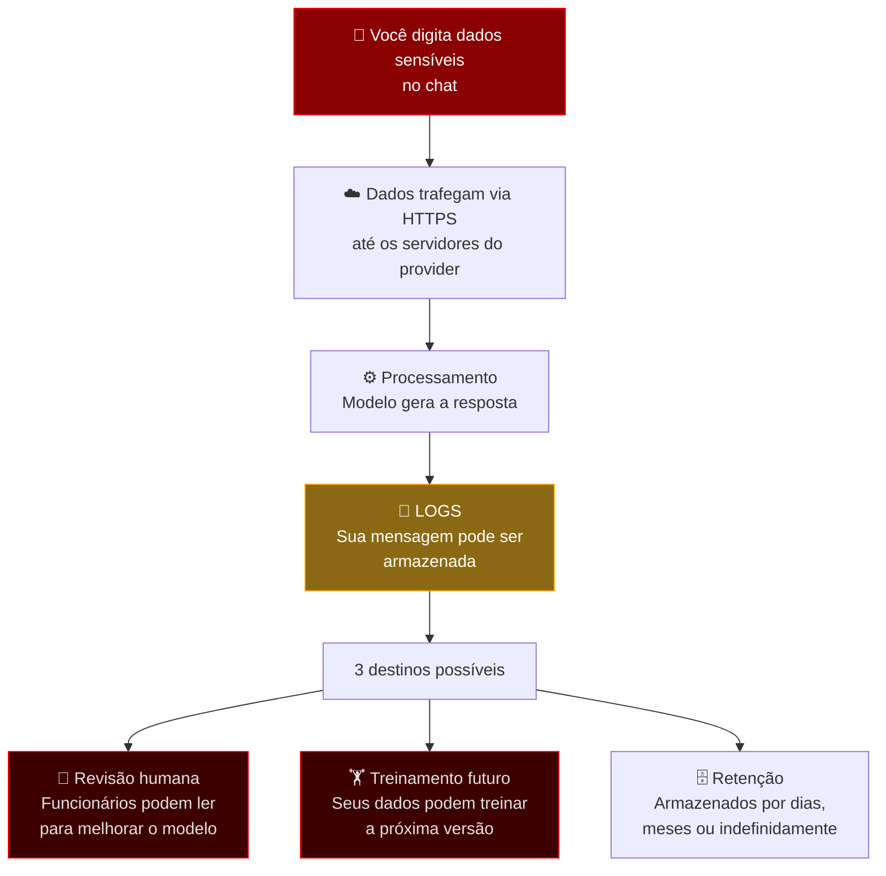
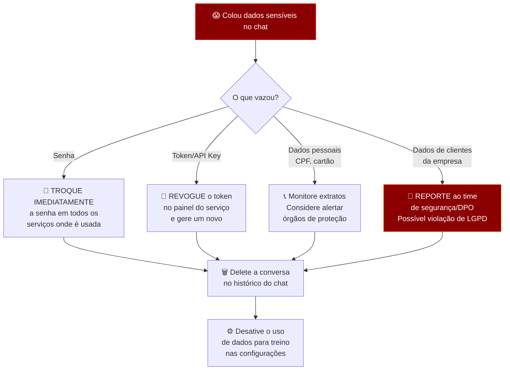
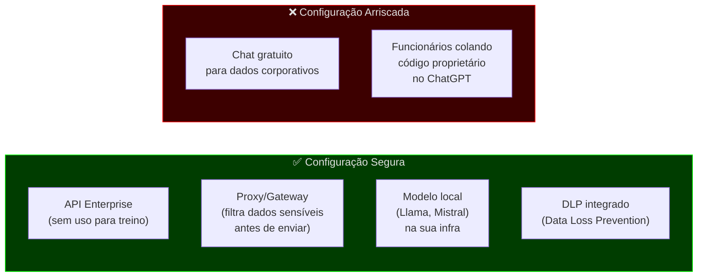

# 🔐 Vazou Senha ou Dados Pessoais no Chat com IA — E Agora?

## O Cenário

Você está usando o ChatGPT, Claude, Gemini ou qualquer outro LLM via chat e, sem querer (ou sem pensar), cola:

- Uma senha ou token de API
- CPF, RG, dados bancários
- Dados de clientes da empresa
- Código com credenciais hardcoded
- Conversas privadas, contratos, laudos médicos

**O que acontece com esses dados?**

---

## 1. O Caminho dos Seus Dados



> [!CAUTION]
> Ao enviar dados para um LLM via chat, eles **saem do seu controle**. Mesmo com boas políticas de privacidade, os dados existem nos servidores de outra empresa.

---

## 2. O Que Cada Provider Faz Com Seus Dados

| | **ChatGPT (OpenAI)** | **Claude (Anthropic)** | **Gemini (Google)** |
|---|---|---|---|
| **Usa para treinar?** | ✅ Sim, no plano gratuito. ❌ Não, no plano pago (Team/Enterprise) | ❌ Não por padrão | ✅ Sim, no plano gratuito |
| **Revisão humana?** | Pode acontecer | Pode acontecer | Pode acontecer |
| **Retenção de logs** | 30 dias (pode variar) | 30-90 dias | Até 18 meses (varia) |
| **Opt-out de treino?** | Sim, nas configurações | Sim, já é padrão | Sim, nas configurações |
| **API (paga)** | ❌ Não treina | ❌ Não treina | ❌ Não treina |

> [!IMPORTANT]
> A maioria dos providers **não usa dados de API paga** para treinamento. Mas os **planos gratuitos de chat** geralmente SIM — inclusive com possibilidade de revisão humana. Um funcionário da OpenAI poderia, em tese, ler a conversa onde você colou sua senha.

---

## 3. Os Riscos Reais

### 3.1 🧠 Memorização pelo Modelo

LLMs podem **memorizar trechos** dos dados de treinamento, especialmente dados que:
- Aparecem múltiplas vezes
- São muito distintos (ex: um número de cartão de crédito é um padrão único e memorável)
- Foram vistos em contextos repetitivos

**Caso real documentado:** Pesquisadores conseguiram extrair e-mails, números de telefone e trechos de código-fonte dos dados de treinamento do GPT-2 e GPT-3, simplesmente pedindo ao modelo que "completasse" certos padrões.

```
Pesquisador: "O e-mail de contato do John é"
GPT-3: "john.doe@empresa-real.com"  ← dado real memorizado
```

> [!WARNING]
> Se seus dados forem usados para treinar uma versão futura, **existe risco (mesmo que pequeno) de que outra pessoa consiga extraí-los** via prompt engineering ou ataques adversariais.

### 3.2 👁️ Revisão Humana

Funcionários dos providers podem ler conversas para:
- Avaliar qualidade das respostas
- Investigar abusos
- Rotular dados para treinamento

Sua senha colada num chat pode ser **lida por um humano real**.

### 3.3 📦 Vazamento do Provider

Se os servidores do provider forem hackeados, seus dados armazenados ficam expostos.

**Caso real:** Em março de 2023, um bug no ChatGPT expôs títulos de conversas de outros usuários. Em outro incidente, dados de pagamento de assinantes foram brevemente visíveis.

### 3.4 🔗 Dados no Contexto Compartilhado

Se você usa features como:
- **GPTs compartilhados** (custom GPTs públicos)
- **Plugins** que enviam dados para terceiros
- **Integrações** com ferramentas externas

Seus dados podem ser enviados para **serviços de terceiros** além do provider principal.

---

## 4. O Que Fazer SE JÁ Vazou

Se você já colou uma senha ou dado sensível num chat com IA:



### Passo a passo imediato:

1. **Troque a senha / revogue o token** — faça isso PRIMEIRO, antes de qualquer outra coisa
2. **Delete a conversa** do histórico do chat
3. **Solicite exclusão** — providers como OpenAI e Anthropic permitem pedir remoção de dados via suporte
4. **Desative treino com seus dados** nas configurações (se ainda não fez)
5. **Se forem dados de terceiros**: reporte ao DPO / time de segurança da empresa — pode ser uma violação de LGPD/GDPR

> [!CAUTION]
> Deletar a conversa **não garante** que os dados foram removidos dos logs internos ou de backups. Se já foram usados para treino, **não há como "destreinar"** o modelo.

---

## 5. Como Se Proteger

### Regras de Ouro

| ✅ Faça | ❌ Nunca faça |
|---|---|
| Use variáveis placeholder: `API_KEY=<SUA_CHAVE>` | Colar senhas, tokens ou chaves reais |
| Anonimize dados antes de enviar | Enviar CPFs, RGs, cartões de crédito |
| Use a API paga (não treina com seus dados) | Usar o plano gratuito para dados corporativos |
| Desative "melhorar modelo" nas configurações | Assumir que "eles não vão ler" |
| Use modelos locais para dados ultra-sensíveis | Colar código com credenciais hardcoded |
| Leia os termos de uso do provider | Colar dados de clientes sem consentimento |

### Para empresas — a configuração correta:



> [!TIP]
> Muitas empresas (Samsung, Apple, JPMorgan) **baniram o uso do ChatGPT** depois que funcionários vazaram código-fonte e dados confidenciais. A Samsung teve código proprietário de chips colado no ChatGPT por engenheiros — esses dados potencialmente entraram no treinamento.

---

## 6. LGPD / GDPR — Implicações Legais

Se você envia **dados pessoais de terceiros** (clientes, pacientes, usuários) para um LLM:

| Risco | Consequência |
|---|---|
| Transferência internacional de dados sem base legal | Multa de até 2% do faturamento (LGPD) ou €20M (GDPR) |
| Falta de consentimento do titular | Violação direta da LGPD Art. 7º |
| Dados usados para treinar modelo de outra empresa | Possível desvio de finalidade (LGPD Art. 6º) |
| Incapacidade de atender pedido de exclusão | Se o modelo "memorizou", não há como apagar |

> [!WARNING]
> Colar dados de clientes num chat com IA pode ser uma **violação da LGPD** mesmo que você não tenha intenção maliciosa. A responsabilidade é da empresa que enviou os dados.

---

## Resumo

> **Trate o chat com IA como um e-mail para um desconhecido.**
>
> Você não colaria sua senha no corpo de um e-mail para alguém que não conhece. Não faça isso com um LLM.
>
> Os dados saem do seu controle no momento em que você clica "Enviar". Podem ser lidos por humanos, armazenados por meses, e potencialmente incorporados ao treinamento de modelos futuros que milhões de pessoas usarão.
