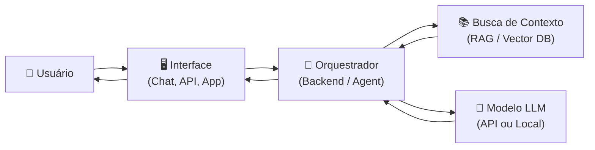
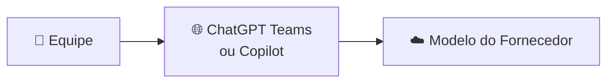
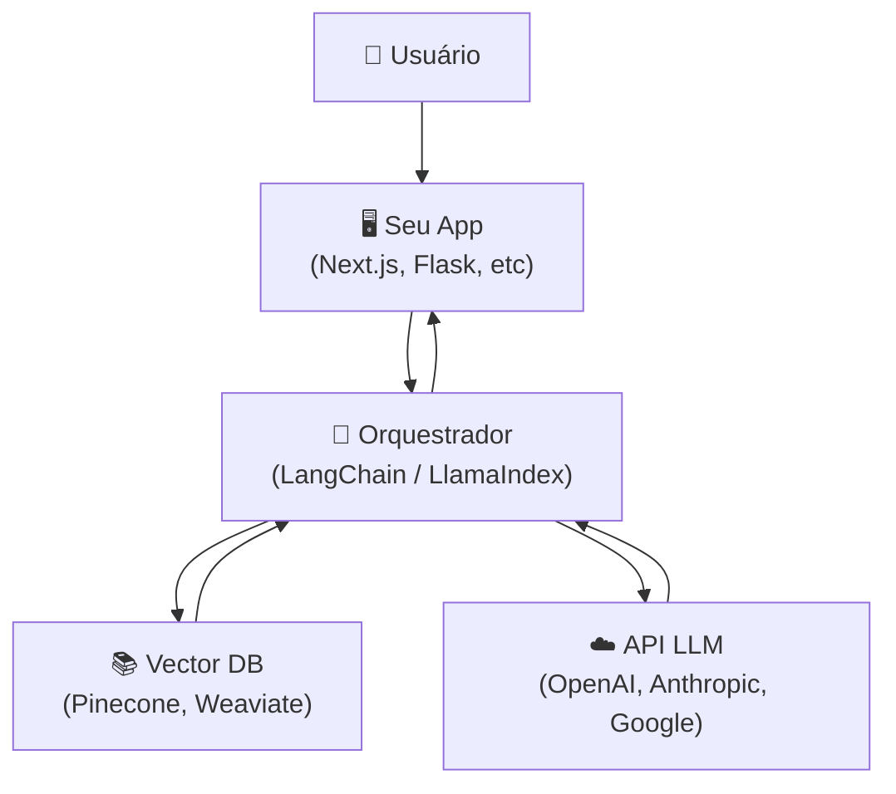
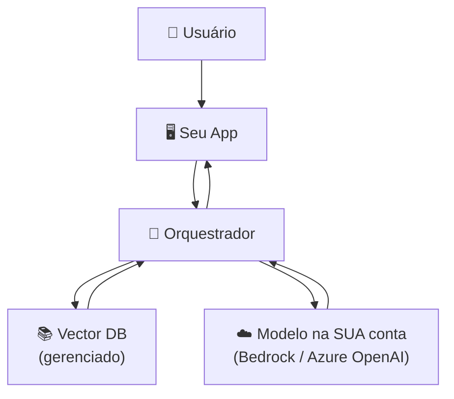
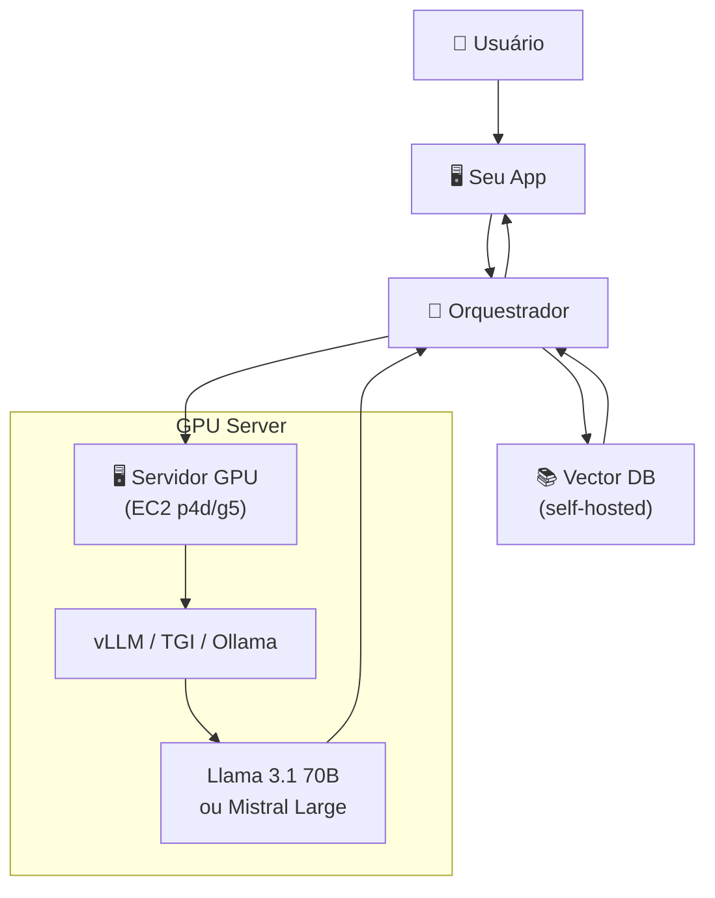
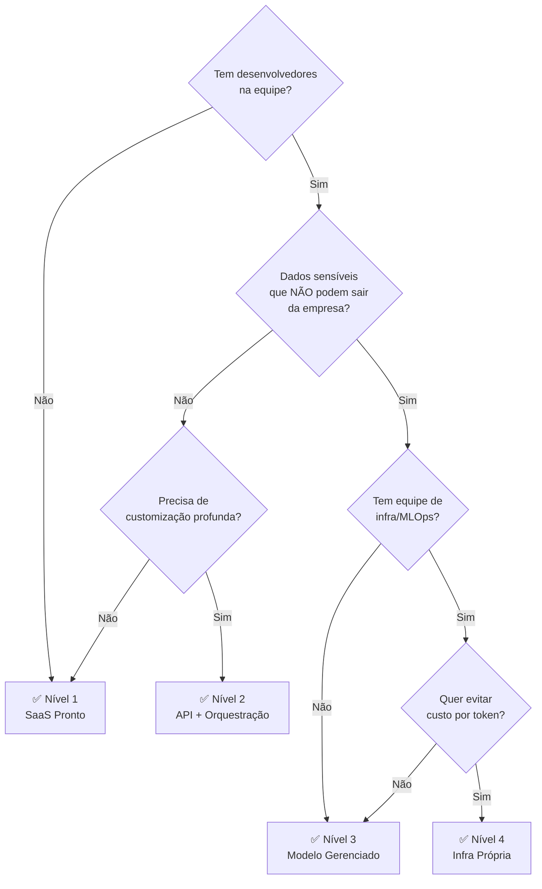

# 🧠 Guia: Montando uma Estrutura de IA na Empresa

## 1. Conceitos Fundamentais

Antes de escolher qualquer ferramenta, entenda as peças do quebra-cabeça:

### O que é um Modelo de IA (LLM)?

É um programa treinado com bilhões de textos que consegue **entender e gerar linguagem natural**. Exemplos: GPT-4, Claude, Llama, Mistral.

> [!NOTE]
> Um modelo sozinho não faz nada útil na empresa. Ele precisa de **contexto** (seus dados) e de uma **interface** (API, chat, agente).

### Glossário Rápido

| Termo | O que é | Analogia |
|---|---|---|
| **LLM** | Modelo de linguagem grande | O "cérebro" |
| **Prompt** | Instrução que você envia ao modelo | A "pergunta" |
| **RAG** | Retrieval-Augmented Generation — buscar docs relevantes antes de perguntar ao modelo | "Estudar antes da prova" |
| **Embedding** | Representação numérica de um texto para busca semântica | "Impressão digital" do texto |
| **Vector DB** | Banco de dados que armazena embeddings | "Biblioteca inteligente" |
| **Fine-tuning** | Retreinar o modelo com seus dados | "Curso de especialização" |
| **Agent** | LLM + ferramentas + loop de decisão | "Estagiário autônomo" |
| **Inference** | Rodar o modelo para gerar uma resposta | "Pensar e responder" |
| **Token** | Unidade de texto (~¾ de uma palavra) | "Sílaba" do modelo |
| **Context Window** | Quanto texto o modelo consegue "ver" de uma vez | "Memória de curto prazo" |

---

## 2. O Fluxo Geral (Independente da Opção)

Qualquer solução de IA na empresa segue este fluxo básico:

**Passo a passo:**
1. Usuário faz uma pergunta
2. O orquestrador busca documentos relevantes (RAG)
3. Monta um prompt com contexto + pergunta
4. Envia pro modelo (API externa ou local)
5. Recebe a resposta e devolve ao usuário

---

## 3. As 4 Opções — Do Mais Simples ao Mais Complexo

### Resumo Comparativo

| | **Nível 1** | **Nível 2** | **Nível 3** | **Nível 4** |
|---|---|---|---|---|
| **Nome** | SaaS Pronto | API + Orquestração | Modelo Local Gerenciado | Infra Própria (EC2) |
| **Exemplo** | ChatGPT Teams, Copilot | OpenAI API + LangChain | AWS Bedrock, Azure OpenAI | EC2 + vLLM + Llama |
| **Controle** | ⭐ | ⭐⭐ | ⭐⭐⭐ | ⭐⭐⭐⭐⭐ |
| **Complexidade** | Baixa | Média | Média-Alta | Alta |
| **Custo inicial** | \$\$ (por seat) | \$ (pay-per-use) | \$\$ | \$\$\$\$ |
| **Privacidade** | Dados saem da empresa | Dados saem (c/ DPA) | Dados na nuvem sua | Dados 100% seus |
| **Time necessário** | 0 devs | 1-2 devs | 2-3 devs | 3-5 devs + MLOps |

---

### Nível 1 — SaaS Pronto (Plug & Play)

> **Para quem:** Quer usar IA amanhã, sem devs.

**Ferramentas:**
- **ChatGPT Teams / Enterprise** — Chat com GPT-4, upload de arquivos, GPTs customizados
- **Microsoft Copilot 365** — IA integrada no Word, Excel, Teams, Outlook
- **Google Gemini for Workspace** — IA integrada no Google Docs, Sheets, Gmail
- **Notion AI** — IA dentro do Notion

**Prós:** Zero setup, já funciona, suporte incluso
**Contras:** Pouca customização, dados podem sair da empresa, custo por usuário

---

### Nível 2 — API + Orquestração (O Mais Comum)

> **Para quem:** Tem 1-2 devs e quer customizar.

**Stack típica:**

| Camada | Opções |
|---|---|
| **Frontend** | Next.js, Streamlit, Gradio |
| **Backend / Orquestrador** | LangChain, LlamaIndex, Haystack, Vercel AI SDK |
| **Vector DB** | Pinecone, Weaviate, Qdrant, ChromaDB, pgvector |
| **LLM Provider** | OpenAI, Anthropic (Claude), Google (Gemini), Cohere |
| **Embeddings** | OpenAI `text-embedding-3`, Cohere Embed, Voyage AI |

**Fluxo RAG detalhado:**

```mermaid
flowchart TD
    subgraph Ingestão ["📥 Ingestão (uma vez)"]
        I1["Documentos\n(PDF, Docs, Slack)"] --> I2["Chunking\n(Dividir em pedaços)"]
        I2 --> I3["Gerar Embeddings"]
        I3 --> I4["Salvar no Vector DB"]
    end

    subgraph Query ["🔍 Query (cada pergunta)"]
        Q1["Pergunta do Usuário"] --> Q2["Gerar Embedding\nda pergunta"]
        Q2 --> Q3["Busca Semântica\nno Vector DB"]
        Q3 --> Q4["Top K documentos\nrelevantes"]
        Q4 --> Q5["Montar Prompt:\nContexto + Pergunta"]
        Q5 --> Q6["Enviar para LLM"]
        Q6 --> Q7["Resposta"]
    end
```

**Prós:** Flexível, custo proporcional ao uso, fácil de iterar
**Contras:** Dados passam pela API do fornecedor (mesmo com DPA), latência de rede

---

### Nível 3 — Modelo Gerenciado na Nuvem

> **Para quem:** Precisa de privacidade e quer usar modelos potentes sem gerenciar GPU.

**Serviços:**
- **AWS Bedrock** — Acesso a Claude, Llama, Mistral, Titan dentro da AWS
- **Azure OpenAI Service** — GPT-4 rodando na sua tenant Azure
- **Google Vertex AI** — Gemini + modelos open-source na GCP
- **AWS SageMaker** — Deploy de qualquer modelo (mais controle, mais trabalho)

**Prós:** Dados ficam na sua conta cloud, compliance mais fácil, boa performance
**Contras:** Custo maior que API direta, vendor lock-in, configuração não trivial

---

### Nível 4 — Infra Própria (EC2 + Modelo Local)

> **Para quem:** Precisa de controle total, tem equipe de infra/MLOps.

**Stack típica:**

| Camada | Opções |
|---|---|
| **Infra** | EC2 (p4d.24xlarge, g5.xlarge), bare metal, Kubernetes |
| **Serving** | vLLM, TGI (Text Generation Inference), Ollama, llama.cpp |
| **Modelos Open** | Llama 3.1 (8B/70B/405B), Mistral, Qwen, DeepSeek |
| **Vector DB** | Qdrant (self-hosted), Milvus, pgvector |
| **Monitoring** | Prometheus + Grafana, Weights & Biases |
| **GPU mínima** | Modelo 7-8B → 1x A10G (24GB) · Modelo 70B → 4x A10G ou 1x A100 |

**Prós:** Controle absoluto, sem custo por token, dados nunca saem
**Contras:** Custo fixo de GPU alto (\$2-30/h por instância), precisa de MLOps, manutenção

---

## 4. Decisão — Por Onde Começar?

---

## 5. Recomendação Pragmática

> [!TIP]
> **Comece pelo Nível 2** (API + RAG). É o melhor custo-benefício para a maioria das empresas.
> Monte um MVP com OpenAI API + LangChain + ChromaDB em **1-2 semanas**.
> Se precisar de mais privacidade, migre para Nível 3 (Bedrock/Azure).
> Só vá para Nível 4 se tiver volume altíssimo ou requisitos regulatórios extremos.

### Próximos Passos Sugeridos

1. **Definir o caso de uso** — Qual problema específico a IA vai resolver? (chatbot interno, análise de docs, geração de relatórios?)
2. **Escolher o nível** — Use o fluxograma acima
3. **Montar um MVP** — 2-4 semanas com escopo reduzido
4. **Validar com usuários reais** — Antes de escalar
5. **Iterar e expandir** — Adicionar RAG, agents, fine-tuning conforme necessidade

---

> [!IMPORTANT]
> **Não comece pelo modelo. Comece pelo problema.**
> A pergunta certa não é "qual LLM usar?" mas sim "que processo da empresa seria 10x melhor com IA?"
